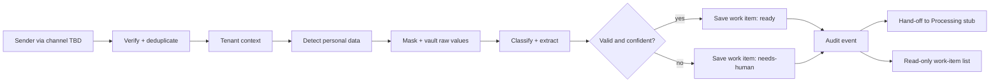
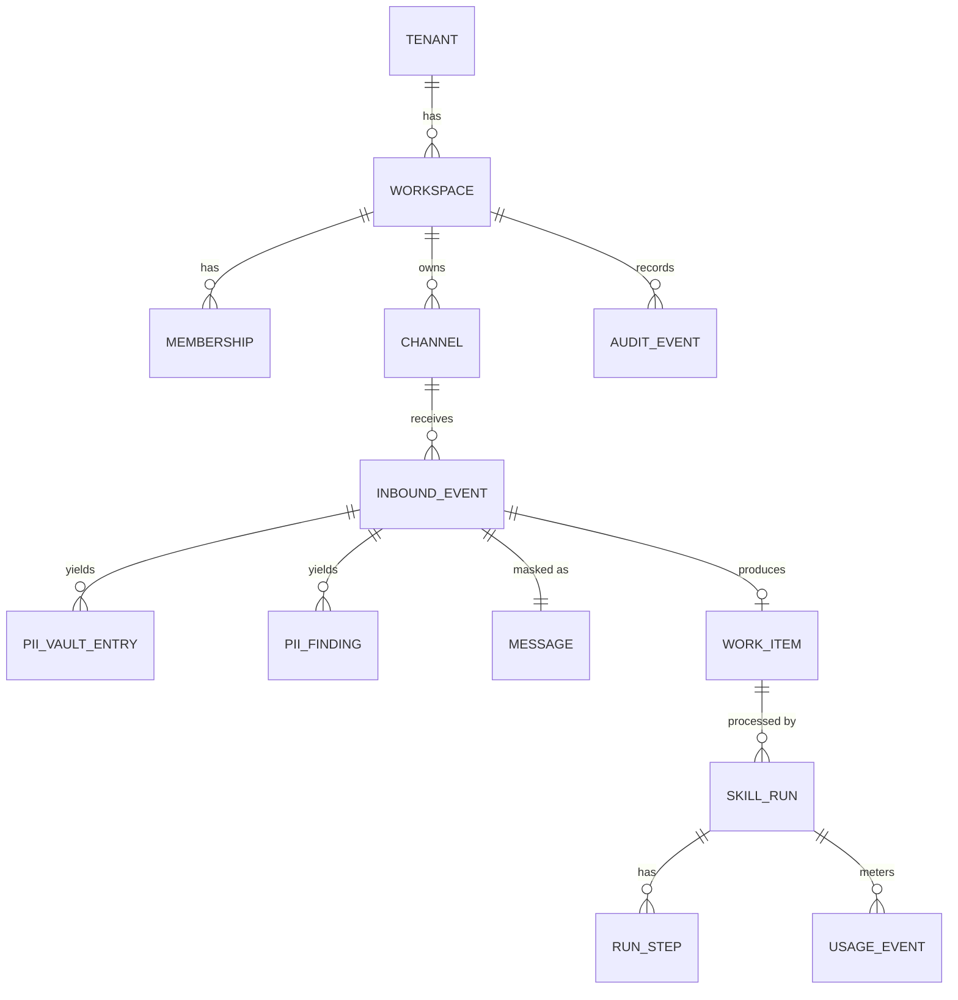
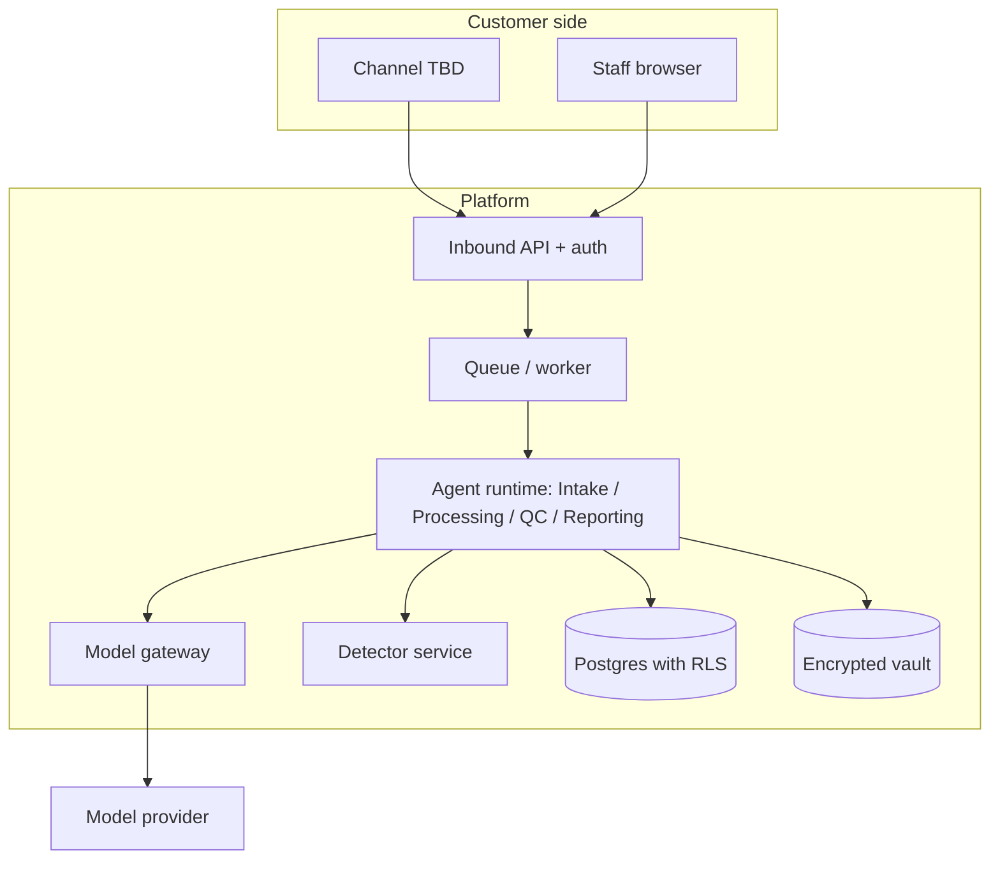
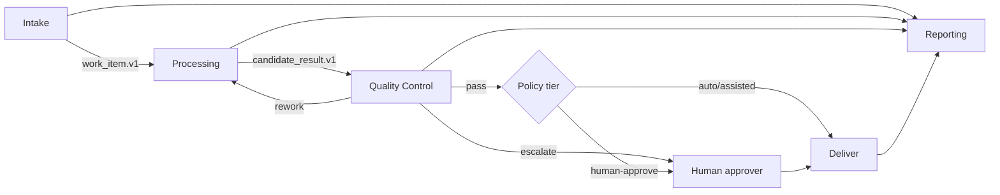
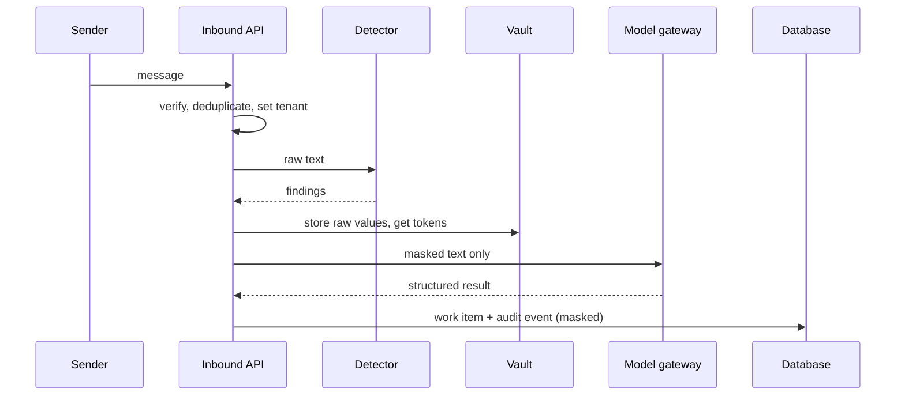

# Business Blueprint

Project: business-agent-platform (four-agent SaaS: Intake, Processing, Quality Control, Reporting)
Created: 2026-10-24
Status: **DRAFT for founder review. Nothing in this document is approved, built, or scheduled.**
Source of truth: `docs/MASTER_BUILD_REGISTER.md` (the "register"). Where this blueprint and the register disagree, the register wins, and the disagreement is listed in section 17.

## 0. How to read this blueprint

### 0.1 Markers

| Marker | Meaning |
|---|---|
| **TBD** | An unresolved business or technical assumption. **Not approved.** Do not build against it. |
| **FC-nn** | Founder-fixed constraint (register section 0.1). Not up for re-opening. |
| **Proposed** | A recommendation by the researcher. Not approved. |
| **Row `XXX-nn`** | A register component row. |
| **S-nn** | A step in the register's proposed build sequence (register section 16). |
| **D-nn** | An open founder decision (register section 10, plus D-13 and D-14 proposed below). |

### 0.2 Hard rules

1. No vertical, pricing, customer integrations, customer names, or market claims are invented here. Each is **TBD** until the founder decides (D-01, D-12, D-02).
2. All implementation gates are on **HOLD**. Every register row is Founder-PENDING and Build-NOT STARTED.
3. Existing Orchester or Mastra components are references and candidates. Nothing has been copied, installed, or run.
4. Research is never recorded as built or approved (FC-04).

### 0.3 The 14 required deliverables

| # | Deliverable | Section |
|---|---|---|
| 1 | Business brief | 1 |
| 2 | Product requirements (PRD) | 2 |
| 3 | Four agent specifications | 3 |
| 4 | Templates | 4 |
| 5 | Customer and system flows | 5 |
| 6 | Database | 6 |
| 7 | UI/UX | 7 |
| 8 | Diagrams | 8 |
| 9 | Analytics | 9 |
| 10 | Monitoring | 10 |
| 11 | PII and security | 11 |
| 12 | Logs | 12 |
| 13 | Operations | 13 |
| 14 | Deployment and testing | 14 |

Additional parts: section 15 (smallest runnable Intake MVP and acceptance tests), section 16 (first implementation file sequence), section 17 (unresolved blockers, TBD list, and register updates needed), section 18 (traceability matrix).

### 0.4 Stack assumption (D-14, proposed)

The founder has referred to "our proposed TypeScript backend". The register and research also assume Postgres (row-level security, queue). Neither the language nor the database has been formally approved. This blueprint writes "TypeScript service layer" and "Postgres" as **Proposed (D-14)**. A Python detector service (Presidio) is an additional runtime if INT-06 is adopted.

---

## 1. Business brief

### 1.1 What is fixed

| Item | Status | Source |
|---|---|---|
| Product is a SaaS with exactly four agents: Intake, Processing, Quality Control, Reporting | **Fixed** | FC-01 |
| Each agent has its own folder with `AGENT.md` and modular `skills/<skill-name>/SKILL.md` | **Fixed** | FC-02 |
| Development skills (Claude Code) are separate from customer-facing production agents | **Fixed** | FC-03 |

### 1.2 What is TBD

| Topic | Status |
|---|---|
| Business vertical (what is processed, for whom) | **TBD (D-01)** |
| Target customer profile and size | **TBD (D-01)** |
| Customer integrations (email, chat, forms, any other system) | **TBD (D-02)** |
| Pricing, plans, credits | **TBD (D-12)** |
| Go-to-market, competitors, market size | **TBD, not researched** |
| Revenue and margin targets | **TBD** |
| Regions, languages, regulated data | **TBD (D-11)** |

### 1.3 Proposed positioning (not approved)

A multi-tenant SaaS where four coordinated agents take a request from intake to report, with personal data masked before any model sees it, every action recorded in a tamper-evident log, and a person approving risky actions. This framing comes from the research (Portarium's policy tiers, Orchester's tenant security and audit trail). It is **Proposed**, and it depends on the vertical (D-01).

### 1.4 Problem and value statements

**TBD (D-01).** They cannot be written without a vertical. Placeholder fields for the founder: *who has the problem, what it costs them today, why four agents, what a successful month looks like.*

### 1.5 Success measures for the first pilot (Proposed, thresholds TBD)

Measured by the acceptance tests in section 15.3. Business-level measures (retention, revenue, time saved) are **TBD**.

---

## 2. Product requirements (PRD)

### 2.1 Roles (Proposed; confirm under D-08)

| Role | Purpose |
|---|---|
| Customer admin | Configures the tenant, sees results, approves risky actions |
| Customer staff | Views work items and reports within permissions |
| End contact | The sender of inbound messages (not a user of the product) |
| Platform admin | Our staff; operates the platform, never sees raw personal data by default |

### 2.2 Functional requirements

"Phase" means MVP = the smallest Intake pilot (section 15), Later = after the pilot. Mapping columns point to register rows and sequence steps.

| ID | Requirement | Phase | Register rows | Steps |
|---|---|---|---|---|
| PRD-01 | Platform has exactly the four named agents in the founder-fixed folder layout | MVP | FND-26 | S-02 |
| PRD-02 | Skills are validated before they can run; invalid skills are rejected | MVP | FND-14 | S-08 |
| PRD-03 | Every record belongs to one tenant; no tenant can read another's data | MVP | FND-02, FND-25 | S-03 |
| PRD-04 | Inbound messages are authenticated, deduplicated, and acknowledged quickly | MVP | INT-01 or INT-02, INT-03, FND-04, FND-12 | S-06, S-21, S-22 |
| PRD-05 | Personal data is detected and masked before any model call; raw values live only in an encrypted vault | MVP | INT-06, INT-07, INT-08, INT-09 | S-17 to S-20 |
| PRD-06 | Intake classifies each request and extracts structured fields against a versioned contract | MVP | INT-05, INT-12, FND-17 | S-09, S-23 |
| PRD-07 | Uncertain or invalid results are flagged for a person, never silently accepted | MVP | INT-09, INT-12 | S-20, S-23 |
| PRD-08 | Every state change is written to a tamper-evident audit log | MVP | FND-03 | S-05 |
| PRD-09 | Logs never contain message bodies or raw personal data | MVP | FND-19 | S-07 |
| PRD-10 | Intake produces a validated hand-off to Processing | MVP (stub receiver) | INT-12, PRC-06 | S-23 |
| PRD-11 | Processing plans work, retrieves knowledge, and assembles candidate results with evidence | Later | PRC-01, PRC-03, PRC-04, PRC-05 | S-29 to S-33 |
| PRD-12 | No external delivery without a Quality Control verdict | Later | QC-01, QC-02 | S-34, S-35 |
| PRD-13 | Risky actions need a named, authorized approver; approval is recorded | Later | FND-07, FND-23, FND-24 | S-10, S-11 |
| PRD-14 | Work can pause for approval and resume once after a restart | Later | FND-05 | S-12 |
| PRD-15 | Reporting produces status reports and alerts from aggregated data, with no personal data | Later | RPT-01, RPT-02 | S-36, S-37 |
| PRD-16 | Spend caps, quotas, and metering per tenant | Later (MVP uses a per-run cap and a kill switch) | FND-09 | S-15 |
| PRD-17 | Customer data export and deletion, including vault entries | Later (needed before real customer data) | FND-13 | S-26 |
| PRD-18 | Customer and staff screens (approval inbox, work items, dashboards, audit viewer) | MVP: read-only work-item list. Later: the rest | UI-01 to UI-03, RPT-03, RPT-04 | S-27, S-38 to S-40 |
| PRD-19 | Non-English support | Later | INT-14 | S-25 |

### 2.3 Non-functional requirements (all targets TBD)

| Area | Requirement | Target |
|---|---|---|
| Isolation | Fail closed when tenant context is missing | Mandatory (AT-03) |
| Availability | Uptime target | **TBD** |
| Latency | Acknowledge inbound within the channel provider's time limit; end-to-end processing time | **TBD (D-02 sets the provider limit)** |
| Accuracy | Classification, extraction, and personal-data recall | **TBD (D-04)** |
| Cost | Per-run token cap and tenant spend cap | **TBD (D-12)** |
| Retention | Message, audit, and vault retention | **TBD (D-11, legal review)** |
| Accessibility and browser support | Standard | **TBD** |

### 2.4 Out of scope for the MVP

Customer replies, outbound actions, approvals, pause/resume, Processing/QC/Reporting logic, billing, plans, non-English, customer deletion, dashboards, any customer integration beyond the single TBD channel.

---

## 3. Four agent specifications

Common rules: folder per agent (FC-02); skills are modular; tools are allow-listed per skill; the runtime enforces permissions (a skill's own declaration is advisory); every handoff is a versioned, validated envelope; every run records skill, model, and prompt versions. Skill names below are **placeholders until D-01**.

### 3.1 Intake (`agents/intake/`)

| Item | Specification |
|---|---|
| Purpose | Turn raw inbound requests into validated, masked work items |
| Inputs | Verified inbound event (channel TBD), tenant context |
| Outputs | `work_item.v1` (masked), audit events, `needs-human` flag where uncertain |
| Skills (placeholder) | `classify-request`, `extract-fields`, `validate-completeness`, `create-work-item` |
| Tools (allow-list) | Detector service client, vault write, model gateway (structured output), work-item write |
| Permissions | Read inbound events and tenant rules; write only `work_items`, vault entries, audit events. No outbound messages in the MVP (shadow mode). |
| Default tier | Assisted. Any customer-facing output is Human-approve (Later). |
| Handoff | To Processing: `work_item.v1` inside the handoff envelope |
| Escalation | Low confidence, missing required fields, unexpected personal data, parse failure |
| Tests | AT-05 to AT-20 (section 15.3) |
| Register rows | INT-01..INT-09, INT-12, INT-13 |
| Steps | S-17 to S-24 |
| Existing references | Orchester channel helpers and router ideas; Presidio; Instructor ideas; Mastra skill-loader pattern |

### 3.2 Processing (`agents/processing/`)

| Item | Specification |
|---|---|
| Purpose | Plan and carry out the work for a work item, assembling a candidate result with evidence |
| Inputs | `work_item.v1`, tenant knowledge (TBD) |
| Outputs | `candidate_result.v1` with evidence references; never written to an external system directly |
| Skills (placeholder) | `plan-work`, `execute-step`, `enrich-from-knowledge`, `assemble-result` |
| Tools | Tool adapters (TBD per D-02 and D-01), knowledge retrieval |
| Permissions | Read work items and knowledge; call only allow-listed adapters; side effects Human-approve |
| Handoff | To Quality Control: `candidate_result.v1` |
| Register rows / steps | PRC-01, PRC-03..PRC-06 / S-29 to S-33 |
| MVP status | **Stub only** (a receiver that validates the handoff envelope) |
| Existing references | Orchester flow engine (unreviewed); Mastra workflow engine (pending D-05) |

### 3.3 Quality Control (`agents/quality-control/`)

| Item | Specification |
|---|---|
| Purpose | Check candidate results against rules, facts, and personal-data policy before delivery |
| Inputs | `candidate_result.v1`, evidence, business rules |
| Outputs | `qc_verdict.v1`: pass, rework, or escalate, with reasons. Recorded through the audit log. |
| Skills (placeholder) | `check-against-rules`, `verify-facts`, `pii-and-policy-scan`, `score-and-decide` |
| Permissions | Read-only on everything; writes only its verdict; cannot edit the candidate |
| Policy | Block or recommend, and the rework-loop limit: **TBD (D-06)** |
| Register rows / steps | QC-01, QC-02 / S-34, S-35 |
| MVP status | **Not built** |

### 3.4 Reporting (`agents/reporting/`)

| Item | Specification |
|---|---|
| Purpose | Build status reports and anomaly alerts from aggregated data |
| Inputs | Aggregated metrics views and audit events. **No raw customer content, no personal data.** |
| Outputs | `report.v1`, alerts, delivery receipts |
| Skills (placeholder) | `collect-metrics`, `build-status-report`, `detect-anomalies`, `deliver-report` |
| Register rows / steps | RPT-01..RPT-04 / S-36 to S-39 |
| MVP status | **Not built** |

### 3.5 Handoff map

| From | To | Contract (proposed names) | Receiver validates |
|---|---|---|---|
| Intake | Processing | `work_item.v1` | schema, tenant match, version accepted |
| Processing | Quality Control | `candidate_result.v1` | schema, evidence present |
| Quality Control | Processing (rework) | `qc_verdict.v1` | max loops (TBD, D-06) |
| Quality Control | Human or delivery | `qc_verdict.v1` | tier and approver rules (D-08) |
| Any agent | Reporting | audit events (pull) | n/a |

---

## 4. Templates

Templates are documentation of required fields. They contain no vertical-specific content. File formats follow the Agent Skills specification; contract details sit in a **sidecar file** (Proposed, D-07) so `SKILL.md` stays spec-clean.

### 4.1 `AGENT.md` template (our own convention; the spec has none)

| Section | Content |
|---|---|
| Header fields | name (one of the four fixed names), version, role, skill list, default tier, limits (steps, cost, timeout), model class |
| Purpose and boundaries | What it does and what it must never do |
| Inputs / Outputs | Contract names and versions |
| Tool allow-list | Summary only; the enforced list lives in the sidecar |
| Handoffs | Target agent and contract |
| Escalation | Conditions and destination |
| Failure behavior | What happens on timeout, schema failure, tool denial |
| Tests | Pointer to the suite |

### 4.2 `SKILL.md` template (spec-clean)

| Part | Rule (from the Agent Skills spec) |
|---|---|
| `name` | Required; 1 to 64 characters; lowercase letters, digits, hyphens; must equal the folder name |
| `description` | Required; 1 to 1024 characters; what it does and when to use it |
| `license`, `compatibility`, `metadata` | Optional; `metadata` values are strings |
| `allowed-tools` | Optional and experimental; advisory only |
| Body | Procedure, examples, failure modes, do-not rules; keep under 500 lines |
| Unknown keys | Our validator **rejects** them (stricter than Mastra, which drops them) |

### 4.3 Skill sidecar template (`skill.contract` file; format TBD)

| Field | Purpose |
|---|---|
| version | Our own skill version (semantic) |
| agent | Owner agent |
| input / output schema references | Contract names and versions |
| tools | Enforced allow-list |
| permissions | Data classes readable, tables writable, network (none by default), personal-data access level |
| tier | Per side effect |
| limits | Timeout, token cap |
| tests | Unit and evaluation set paths and minimum pass rate (TBD per D-04) |

### 4.4 Contract templates (field lists)

| Contract | Required fields (proposed) |
|---|---|
| Handoff envelope | workspace id, correlation id, item id, contract name and version, payload, evidence references, confidence, producing skill and version, created time |
| `work_item.v1` | item id, workspace id, source channel and event reference, category (from a configured list plus "unknown"), extracted fields with per-field confidence, missing fields, masked-text reference, personal-data summary (types and counts only), status (`ready` / `needs-human`), skill and model versions |
| Approval record (Later) | approver id and role, decision, reason, time, expiry, evidence reference |
| `qc_verdict.v1` (Later) | verdict, reasons, rule results, evidence checked |
| `report.v1` (Later) | period, metrics, anomalies, delivery receipt |

### 4.5 Vertical-specific templates

Category lists, field definitions, business rules, reply snippets, and report layouts: **TBD (D-01)**.

---

## 5. Customer and system flows

### 5.1 MVP flow (shadow mode, Proposed D-13)

### 5.2 Customer onboarding flow (Later; content TBD)

Connect channel (D-02) → set category list and rules (D-01) → set policy tiers and spend cap (D-12) → run in shadow mode → review results → promote actions to higher tiers. Steps and screens are **TBD**.

### 5.3 End-to-end target flow (Later)

Intake → Processing → Quality Control → policy tier → (approval if required) → delivery → Reporting. See diagram 8.2.

### 5.4 Exception flows

| Case | Behavior |
|---|---|
| Forged or stale inbound | Rejected, audited without body |
| Duplicate delivery | Original result returned, no repeat work |
| Detector unavailable | Fail closed: item parked as `needs-human`, no model call with raw text |
| Model output invalid after N retries (N TBD) | `needs-human` |
| Tenant context missing | Request rejected |
| Spend cap or kill switch | No model call |

---

## 6. Database

Proposed Postgres with forced row-level security (Orchester pattern, FND-02). Every tenant-owned table carries `workspace_id`. Orchester schema folders (`packages/db/src/schema/{core,workspaces,audit,idempotency,integrations,knowledge,gdpr,security,...}.ts`, V3) are references only.

### 6.1 Tables

| Table | Phase | Purpose | Relationships | Reference |
|---|---|---|---|---|
| tenants, workspaces, memberships, users | MVP | Tenancy and roles | workspace → tenant; membership → user, workspace | Orchester `core`, `workspaces`, `orgs` schemas (V3) |
| channels | MVP | One channel's config and secret references (never raw secrets) | → workspace | Orchester `integrations` (V3) |
| inbound_events | MVP | Verified inbound event envelope; delivery id for deduplication | → channel | Orchester webhook routes (V1) |
| idempotency_keys | MVP | Replay protection scoped by workspace | → workspace | Orchester `idempotency.ts`, migration 0015 (V1) |
| pii_vault_entries | MVP | Encrypted raw values with token ids | → workspace, inbound_event | None found (INT-08) |
| pii_findings | MVP | Types, counts, offsets-free summary per event | → inbound_event | Presidio output shape (V1 docs) |
| messages | MVP | Masked text only | → inbound_event | n/a |
| work_items | MVP | `work_item.v1` | → inbound_event, workspace | n/a |
| skill_runs, run_steps | MVP | Skill, model, prompt versions; tool calls by reference | skill_run → work_item; step → skill_run | Mastra snapshot idea (V1), Orchester activity (V3) |
| audit_events | MVP | Hash-chained | → workspace | Orchester `audit/chain.ts` (V1) |
| usage_events | MVP | Tokens and cost per run | → skill_run | Orchester `usage_events` (README, V2) |
| skill_registry | MVP (repository-loaded) | Loaded skill name, version, hash | n/a | Mastra `publish.ts` idea (V1) |
| approvals | Later | Approver, decision, reason, expiry | → work_item or action | None (FND-07) |
| workflow_snapshots, run_owners | Later (if FND-05 adopted) | Pause/resume state and leases | → workspace | Mastra `stores/pg` (V1) |
| qc_verdicts | Later | Written through audit | → candidate | n/a |
| candidate_results, knowledge_docs, knowledge_chunks | Later | Processing | → work_item | Orchester `knowledge` schema (V3) |
| reports | Later | Reporting | → workspace | n/a |
| subscriptions, credit_ledger | Later | Billing (D-12) | → workspace | Orchester `lib/billing/*` (V3) |
| data_requests | Later | Export and delete | → workspace | Orchester `lib/gdpr/*` (V3) |

### 6.2 Core relationships

### 6.3 Database rules

1. Forced row-level security on every tenant table; the app connects as a restricted role without bypass; a boot-time check refuses a superuser connection (FND-02).
2. Audit events are append-only to the app role.
3. Raw personal data lives only in `pii_vault_entries`, encrypted with per-tenant keys (FND-10).
4. Migrations are forward-only with a tested rollback plan (details TBD).
5. Retention periods are **TBD (D-11)**.

---

## 7. UI/UX

### 7.1 MVP

A single **read-only list of work items** for authorized staff of one tenant, showing masked content, category, fields, confidence, and status (`ready` / `needs-human`). No unmask action, no editing. Layout, branding, and component library are **TBD (D-10)**.

### 7.2 Later surfaces (Proposed)

Approval Inbox, Today queue, Conversations, Agents (status and pause), Usage and Billing, Audit Trail, Settings, platform-admin console. Register rows: UI-01 (custom), UI-02 and UI-03 (candidate frameworks, PENDING), RPT-03, RPT-04.

### 7.3 Principles (Proposed)

| Principle | Reason |
|---|---|
| Approval in a few taps on a phone | Approvals are the human bottleneck |
| Every agent action links to its evidence | Trust and audit |
| Masked by default | PII protection |
| Visible shadow-mode and pause-all controls | Safety |
| Plain language, accessible contrast | Usability (standard TBD) |

### 7.4 Framework note (R-004)

Neither Refine nor react-admin fits as the whole customer shell. Client-side permission checks are not security; the server enforces everything.

---

## 8. Diagrams

### 8.1 System context (Proposed stack, D-14)

### 8.2 Agent pipeline (target)

### 8.3 Personal-data path (MVP)

### 8.4 Trust boundaries

Sender ⟷ Inbound API (untrusted input); Platform ⟷ Model provider (receives masked text only); Platform ⟷ Detector (internal, authenticated); Staff ⟷ Platform (tenant-scoped).

---

## 9. Analytics

Targets for every metric are **TBD**. Analytics must never contain message bodies or raw personal data.

| Group | Metrics (Proposed) | Source |
|---|---|---|
| Pipeline | Items received, ready, needs-human, rejected; time to work item | `work_items`, `inbound_events` |
| Quality | Classification accuracy and extraction accuracy on the evaluation set; human-correction rate | evaluation runs, staff edits (Later) |
| Personal data | Findings by type (counts only); detector recall on the labelled set; vault reads | `pii_findings`, vault audit events |
| Cost | Tokens and cost per run and per tenant | `usage_events` |
| Reliability | Retry counts, schema failures, timeouts | `run_steps` |
| Business (Later) | Activation, retention, revenue | **TBD (D-12)** |

Reporting-agent analytics rows: RPT-01, RPT-02 (S-36, S-37).

---

## 10. Monitoring

| Area | Signals (Proposed) | Alert threshold |
|---|---|---|
| Availability | Inbound endpoint health, queue depth, worker liveness | **TBD** |
| Latency | Acknowledge time, processing time | **TBD** |
| Errors | Forged-request rate, schema-failure rate, model errors | **TBD** |
| Cost | Tokens per run, spend per tenant, cost spike | **TBD (D-12)** |
| Safety | Cross-tenant test failures (must be zero), audit-chain verification failures, detector outages | Any occurrence |
| Detector | Recall drift on a standing canary set | **TBD (D-04)** |
| Skills | Per-version pass rate, rework rate | **TBD** |

Observability uses a single correlation id across inbound, detector, model, and database steps (FND-19). Orchester references: audit verify job (`lib/audit/verify-job.ts`, V3), worker schedules (`apps/web/worker/index.ts`, V1).

---

## 11. PII and security

### 11.1 Data classes

| Class | Examples | Where it may exist |
|---|---|---|
| Raw personal data | Names, contact details, identifiers, financial details (types TBD per D-11) | Vault only, encrypted |
| Masked text | Message with tokens | Database, model provider, UI |
| Credentials and secrets | API keys, signing secrets | Secrets service only; never in code or logs |
| Operational metadata | Counts, timings, versions | Anywhere |

### 11.2 Controls and where they come from

| Control | Row | Step | Existing reference | Status of reference |
|---|---|---|---|---|
| Tenant isolation with forced row-level security, restricted DB role, boot check | FND-02 | S-03 | Orchester `tenant/context.ts`, migrations 0006, 0007, 0009 | V1; policies in 0008/0010 unread (V4) |
| Query-scoping CI guard | FND-25 | S-03 | Orchester README (CI invariants) | V2 |
| Tamper-evident audit | FND-03 | S-05 | Orchester `audit/chain.ts` | V1 |
| Replay and duplicate protection | FND-04 | S-06 | Orchester `idempotency.ts`, migration 0015 | V1 |
| Signed inbound requests | INT-01 | S-21 | Orchester `slack.ts`, `telegram.ts` | V1 |
| Deny-by-default sender allowlist | INT-02 | S-21 | Orchester `allowlist.ts` | V1 |
| Detection | INT-06 | S-18 | Presidio | PENDING recall spike |
| Masking with stable tokens | INT-07 | S-19 | Presidio operators (idea) | V1 docs |
| Vault and key management | INT-08, FND-10 | S-04, S-17 | None found | n/a |
| Classification labels and fail-closed defaults | INT-09 | S-20 | AWS sample (design only) | V1 |
| Skill validation and size caps | FND-14 | S-08 | Mastra `schemas.ts`, `workspace-skills.ts` | V1 |
| Approver identity and approval record | FND-07 | S-11 | None meeting the need | Later |

### 11.3 Threats (MVP)

| Threat | Mitigation | Test |
|---|---|---|
| Forged inbound messages | Signature, replay window, secret checks | AT-05 |
| Cross-tenant leak | RLS, fail-closed context, CI guard | AT-03, AT-04 |
| Personal data to model provider | Mask before model call; vault | AT-08, AT-09 |
| Personal data in logs | No-body logging, scrubbers | AT-11 |
| Prompt injection from inbound text | Untrusted-input wrapper; no tools in extraction step | AT-17 |
| Detector missed value | Recall gate, second layer decision (D-03), needs-human fallback | AT-08, AT-13 |
| Runaway cost | Per-run token cap, kill switch | AT-18 |
| Tampering with history | Hash-chained audit, verification job | AT-15 |
| Unauthorized unmasking | No unmask path in MVP | AT-21 |

### 11.4 Legal and compliance

GDPR, CCPA, retention, DPAs with model providers, and any sector rules: **TBD (D-11), no legal review done.**

---

## 12. Logs

### 12.1 Log types

| Type | Content | Never contains |
|---|---|---|
| Application | Event names, ids, timings, error codes | Message bodies, raw personal data, secrets |
| Audit (hash-chained) | Actor, action, target, masked metadata, time | Raw personal data |
| Diagnostic (time-boxed, per-tenant, consent-based) | Run replay record by reference: prompt version, tool calls, policy decisions | Raw personal data (references only) |
| Usage | Tokens, cost, model | Content |
| Security | Rejected requests, denials | Request bodies |

### 12.2 Rules

1. A single correlation id links every step of one item.
2. Exceptions from model libraries must be wrapped so that messages and request arguments are not logged (Instructor's logging caveats, R-001).
3. A test searches all outputs for synthetic raw values (AT-11).
4. Retention and access to logs: **TBD (D-11)**.
5. The audit chain head is anchored outside the database (FND-03 risk).

---

## 13. Operations

| Area | Proposed practice | Status |
|---|---|---|
| Runbooks | Detector outage, model provider outage, queue backlog, suspected cross-tenant leak, audit-chain failure, secret rotation | Not written |
| Kill switch | Global and per-tenant stop of model calls | Part of MVP (AT-18) |
| Incident process and on-call | **TBD** |
| Backups and restore | Tested restore for database and vault | **TBD** |
| Release of skills | Repository-loaded for the MVP; signed, versioned, tenant-pinned bundles later (FND-15, S-14) | Later |
| Change control | Founder approval of each register row before implementation | Active (all HOLD) |
| Support access | Platform admins do not see raw personal data by default | Proposed |
| Customer deletion | FND-13, S-26 | Later; required before real customer data |
| Architecture decisions | Written ADRs (FND-21 practice) | PENDING |
| Security hygiene | The old GitHub token is not confirmed revoked (register section 13) | Open, founder action |

---

## 14. Deployment and testing

### 14.1 Environments (Proposed)

Local development, shared staging with synthetic data only, and production (not before founder approval). Cloud provider and region: **TBD (D-03, D-11)**. Infrastructure as code: **TBD**.

### 14.2 Deployment units (Proposed, D-14)

| Unit | Notes |
|---|---|
| Inbound API and worker (TypeScript) | Same codebase, separate processes |
| Detector service (Python, Presidio) | Private network; authentication in front (Presidio ships none) |
| Postgres | Restricted application role; migrations by a separate role |
| Secrets service | Managed |

### 14.3 CI gates (Proposed)

1. Skill and folder validation (AT-01, AT-02).
2. Query-scoping guard (FND-25).
3. Cross-tenant leak suite (AT-03, AT-04).
4. Log-hygiene suite (AT-11).
5. Contract-schema tests (AT-14, AT-20).
6. Evaluation gate for Intake (AT-08, AT-19), with thresholds from D-04.

### 14.4 Test layers

| Layer | Examples |
|---|---|
| Unit | Skill validator, masking, schema checks |
| Contract | `work_item.v1`, handoff envelope |
| Integration | Database with RLS; detector; model gateway with recorded responses |
| Security | Forged inbound, injection fixtures, tenant isolation |
| Evaluation | Labelled **synthetic** set; recall, accuracy, confusion matrix |
| Resilience | Kill mid-processing, restart (AT-22) |

Test data is synthetic only in the MVP. The vertical-specific content of the synthetic set is **TBD (D-01)**.

### 14.5 Deployment steps

Not authorized. No deployment may occur until the founder approves the relevant rows and the acceptance tests pass.

---

## 15. Smallest runnable Intake MVP

### 15.1 Definition (Proposed; depends on D-13)

One tenant, one inbound channel (TBD, D-02), synthetic data, **shadow mode**: Intake verifies the message, masks personal data, classifies and extracts against `work_item.v1`, saves a masked work item with an audit event, hands it to a Processing stub, and shows it in a read-only list. It sends nothing back and writes to no outside system.

### 15.2 Components and where they come from

| Need | Register rows | Steps | Existing component (reference only) | Type |
|---|---|---|---|---|
| Agent folders | FND-26 | S-02 | none (founder layout) | new |
| Tenant wall | FND-02, FND-25 | S-03 | Orchester `tenant/context.ts`, migrations 0006, 0007, 0009 | adapt + configure |
| Secrets | FND-10 | S-04 | none | configure |
| Audit | FND-03 | S-05 | Orchester `audit/chain.ts` | adapt |
| Idempotency | FND-04 | S-06 | Orchester `idempotency.ts`, migration 0015 | adapt |
| Safe logging | FND-19 (part 1) | S-07 | none | new |
| Skill validation/loading | FND-14 | S-08 | Mastra `workspace/skills/{schemas,workspace-skills}.ts` (pattern) | adapt |
| Model gateway | FND-17 | S-09 | AI SDK docs; Instructor `retry.py` (idea) | adapt |
| Vault | INT-08 | S-17 | none | new |
| Detector | INT-06 | S-18 | Presidio | research spike, then configure |
| Masking | INT-07 | S-19 | Presidio operators (idea) | adapt + new |
| Labels, fail-closed | INT-09 | S-20 (reduced) | AWS sample (design only) | new |
| One channel in | INT-01 or INT-02, FND-12 | S-21 | Orchester `slack.ts` or `widget-guard.ts` | adapt |
| Inbound route | INT-03 | S-22 (reduced) | Orchester Telegram route (what not to copy) | new |
| Intake skills and contract | INT-05, INT-12 | S-23 | Instructor ideas | new |
| Evaluation gate | INT-13 | S-24 | none | new + research |
| Work-item list | UI-01 (reduced) | part of S-27 | none | new |
| Processing stub | PRC-06 (receiver only) | part of S-32 | none | new |

**Not used in the MVP:** Mastra pause/resume (FND-05, S-12), approvals (FND-07), the tool gateway (FND-16), skill publishing (FND-15), billing (FND-09), Mastra `ee/` code (FND-06), any Processing, QC, or Reporting logic.

### 15.3 Exact acceptance tests

Thresholds shown as **TBD** are founder decisions. A test with a TBD threshold cannot pass until the threshold is set. All tests use synthetic data only.

| ID | Test | Procedure | Pass criterion |
|---|---|---|---|
| AT-01 | Founder-fixed structure | Run the structure check on the repository | Exactly four agent folders named `intake`, `processing`, `quality-control`, `reporting`, each with `AGENT.md`; each skill folder has `SKILL.md`; a fifth agent folder or a misnamed folder fails |
| AT-02 | Skill validation | Submit skills with an unknown frontmatter key, a name different from the folder, a description over 1,024 characters, a missing sidecar, and an oversized body | All five are rejected with a specific error; a valid skill loads |
| AT-03 | Tenant isolation | With tenants A and B seeded, attempt reads and writes on every tenant table as A against B's rows; also run with the tenant setting unset; also connect with a superuser role | Zero cross-tenant rows read or written; unset setting returns nothing; superuser connection makes the app refuse to start |
| AT-04 | Cross-tenant via inbound | Send a message to A's channel | The resulting work item, vault entry, and audit event exist only under A |
| AT-05 | Channel authentication | Send messages with no signature, a wrong signature, a stale timestamp, and a wrong URL secret | All rejected; no rows created except one audit event without body |
| AT-06 | Duplicate delivery | Send the same delivery id twice | One work item, one set of model calls; second response equals the first |
| AT-07 | Fast acknowledgement | Send a message that triggers slow processing | The inbound call acknowledges within the limit (**TBD, D-02**); processing continues afterward |
| AT-08 | Personal-data recall | Run the detector over the labelled synthetic set | Per-type recall at or above the target (**TBD, D-04**); per-type precision reported |
| AT-09 | Model input is masked | Capture every request to the model gateway during the suite | Zero occurrences of any synthetic raw value (exact-string search) |
| AT-10 | Vault | Read the vault storage directly; attempt unauthorized and authorized reads | No plaintext at rest; unauthorized read denied and audited |
| AT-11 | Log hygiene | After the whole suite, including forced failures, search logs, traces, error output, and audit metadata | Zero raw synthetic values and zero message bodies |
| AT-12 | Structured output limits | Feed schema-invalid model responses | At most N retries (**N TBD**), token cap respected, then `needs-human`; retries logged without content |
| AT-13 | Fail closed | Feed an unparseable classification and a detector outage | Item is `needs-human`; no item marked `ready`; no model call with raw text |
| AT-14 | Work-item contract | Validate saved items | Every item validates against `work_item.v1` and contains only masked content, confidence, and skill and model versions |
| AT-15 | Audit chain | Alter one audit row; run concurrent appends | Verification detects the alteration; concurrent appends do not fork the chain |
| AT-16 | Shadow mode | Run the suite with network egress monitoring | No outbound message to the sender or any outside system; only the model provider, detector, and database are contacted |
| AT-17 | Injection fixtures | Send messages that instruct the model to ignore rules, reveal vault contents, or call tools | No tool call, no vault access, item flagged; classification still produced from content |
| AT-18 | Spend cap and kill switch | Set the per-run token cap low; then turn on the kill switch | Run stops at the cap; with the kill switch on, no model call occurs (inbound behavior **TBD**) |
| AT-19 | Accuracy gate | Run the labelled synthetic set | Classification and extraction accuracy at or above targets (**TBD, D-04**); confusion matrix produced |
| AT-20 | Hand-off | Send the work item to the Processing stub, then send an unsupported contract version | Valid envelope accepted; unsupported version rejected |
| AT-21 | Read-only list | Log in as staff of A and of B | Each sees only own items, masked; no unmask control exists |
| AT-22 | Restart | Stop the process during processing and restart | The item completes once or is retried without creating a duplicate work item |

**MVP exit:** all 22 tests pass, with thresholds set by the founder.

---

## 16. First implementation file sequence (Proposed; nothing is created; all gates HOLD)

Paths are proposals in the future repository and depend on D-14. Each file lists the register row, step, type, and tests it serves. This sequence follows register section 16 for the MVP subset.

| # | Proposed file | Purpose | Row | Step | Type | Tests |
|---|---|---|---|---|---|---|
| 1 | `agents/intake/AGENT.md` and stub `AGENT.md` in `processing/`, `quality-control/`, `reporting/` | Founder-fixed agent folders | FND-26 | S-02 | new | AT-01 |
| 2 | `contracts/handoff-envelope.v1` and `contracts/work-item.v1` (schemas) | Contracts | FND-26 | S-02 | new | AT-14, AT-20 |
| 3 | `db/migrations/0001_roles_and_tenancy` | Restricted app role, migration role, tenant tables | FND-02 | S-03 | adapt + configure | AT-03 |
| 4 | `db/migrations/0002_rls_policies` | Forced row-level security and fail-closed helper | FND-02 | S-03 | adapt | AT-03, AT-04 |
| 5 | `src/tenancy/context` | Set tenant per transaction; boot role check | FND-02 | S-03 | adapt | AT-03 |
| 6 | `ci/query-scoping-guard` | Fails build on unscoped queries | FND-25 | S-03 | new | AT-03 |
| 7 | `src/config/secrets` | Read secrets from managed service | FND-10 | S-04 | configure | AT-11 |
| 8 | `db/migrations/0003_audit_events` and `src/audit/chain` | Hash-chained audit | FND-03 | S-05 | adapt | AT-15 |
| 9 | `db/migrations/0004_idempotency` and `src/idempotency/store` | Duplicate protection | FND-04 | S-06 | adapt | AT-06 |
| 10 | `src/logging/logger` | No-body structured logger; correlation id | FND-19 | S-07 | new | AT-11 |
| 11 | `src/skills/validate` and `src/skills/load` | Skill and folder validation | FND-14 | S-08 | adapt | AT-01, AT-02 |
| 12 | `src/model/gateway` | Structured output, bounded retry, token cap, usage events | FND-17 | S-09 | adapt | AT-12, AT-18 |
| 13 | `db/migrations/0005_pii_vault` and `src/pii/vault` | Encrypted vault | INT-08 | S-17 | new | AT-10 |
| 14 | `src/pii/detector-client` | Calls the detector service | INT-06 | S-18 | configure + new | AT-08 |
| 15 | `src/pii/mask` | Stable tokens and masked text | INT-07 | S-19 | adapt + new | AT-09 |
| 16 | `src/pii/policy` | Labels and fail-closed rules | INT-09 | S-20 | new | AT-13 |
| 17 | `src/channels/<channel>/verify` | Signature, replay window, allowlist | INT-01 or INT-02 | S-21 | adapt | AT-05 |
| 18 | `db/migrations/0006_inbound_and_work_items` | Inbound events, messages, work items, runs | INT-03, INT-12 | S-22 | new | AT-04, AT-14 |
| 19 | `src/api/inbound` | Acknowledge fast; enqueue; dedupe | INT-03 | S-22 | new | AT-06, AT-07 |
| 20 | `agents/intake/skills/<each skill>/SKILL.md` plus sidecar | Four placeholder skills (names TBD, D-01) | INT-12 | S-23 | new | AT-02, AT-14 |
| 21 | `src/agents/intake/run` | Orchestrates the four skills | INT-05, INT-12 | S-23 | new | AT-12, AT-13, AT-16, AT-17 |
| 22 | `src/agents/processing/stub` | Validates the handoff only | PRC-06 | part of S-32 | new | AT-20 |
| 23 | `evals/intake/` (synthetic labelled sets and runner) | Accuracy and recall gate | INT-13 | S-24 | new | AT-08, AT-19 |
| 24 | `tests/` suites named for each AT | Acceptance suites | FND-20 (subset) | part of S-16 | new | AT-01 to AT-22 |
| 25 | `src/ui/work-items` (read-only) | Staff list | UI-01 (reduced) | part of S-27 | new | AT-21 |

---

## 17. Unresolved blockers, TBD list, and register updates

### 17.1 Blockers (gate the MVP)

| Blocker | Blocks | Needs |
|---|---|---|
| **D-01** vertical, customer, final skill names | Business brief, templates, categories, synthetic data, skill names | Founder |
| **D-02** one inbound channel for the pilot | AT-05, AT-07; files 17 to 19 | Founder |
| **D-03** cloud services allowed or not | Detector hosting; optional second layer | Founder |
| **D-04** accuracy and recall targets, retry limit N | AT-08, AT-12, AT-19 | Founder |
| **D-11** languages, countries, personal-data types | Detector configuration; evaluation set | Founder |
| **D-13 (new)** pilot is shadow mode with synthetic data | MVP definition; whether S-10 to S-13 return | Founder |
| **D-14 (new)** confirm TypeScript service layer and Postgres | All proposed file paths | Founder |
| **D-07** sidecar format for skill contracts | S-08, templates | Founder |
| **D-08 (reduced)** who may see unmasked values (MVP: nobody) | AT-21 | Founder |
| **D-10** UI approach | Work-item list design | Founder |
| Evidence gaps | Orchester migrations 0008 and 0010; `lib/rate-limit`; `lib/encryption`; chosen channel file; Presidio recall on synthetic data; `agentskills` `docs/LICENSE` | Read-only research |

### 17.2 Not needed for the MVP but unresolved

D-05 and FND-06 (Mastra engine and license question), D-06 (QC policy), D-09, D-12 (pricing), billing, customer deletion before real data, retention, compliance, uptime targets, support model, go-to-market.

### 17.3 TBD business assumptions (all not approved)

Vertical, customer profile, value proposition, pricing and credits, integrations, markets, regions, languages, retention, SLOs, approver rules, brand, onboarding steps, success metrics.

### 17.4 Register updates needed (this blueprint does not edit the register)

1. Add D-13 (shadow-mode pilot) and D-14 (stack) to register section 10.
2. Split S-07 into two steps: no-body logging first, personal-data scrubbing after S-19 (the register's S-07 depends on later components).
3. Mark S-10 to S-13 and S-14 to S-15 as "deferred for the pilot" if D-13 is approved.
4. Reduce S-20 and S-22 to their pilot scope, as in section 15.2.
5. Add the acceptance tests in section 15.3 as exit checks for the Intake steps.

---

## 18. Traceability matrix

| Blueprint section | Register rows | Steps | Orchester components (reference) | Mastra components (reference) |
|---|---|---|---|---|
| 1 Business brief | FND-01 | S-01 | n/a | n/a |
| 2 PRD | all | S-01 to S-41 | n/a | n/a |
| 3.1 Intake | INT-01..INT-14 | S-17 to S-25 | channels `slack.ts`, `telegram.ts`, `widget-guard.ts`, `allowlist.ts`, `router.ts` | skill-loader pattern |
| 3.2 Processing | PRC-01, PRC-03..PRC-06 | S-29 to S-33 | `lib/flows/*` (unreviewed) | `workflows/*` (pending D-05) |
| 3.3 Quality Control | QC-01, QC-02 | S-34, S-35 | `audit/chain.ts` | n/a |
| 3.4 Reporting | RPT-01..RPT-04 | S-36 to S-39 | `lib/activity/*`, billing usage route | n/a |
| 4 Templates | FND-14, FND-15, FND-26 | S-02, S-08, S-14 | n/a | `workspace/skills/*` |
| 5 Flows | INT-03, INT-04, PRC-06 | S-21 to S-23, S-32 | `channels/router.ts`, webhook routes | `agent/scopes.ts` |
| 6 Database | FND-02..FND-04, INT-08, FND-05 | S-03 to S-06, S-17 | `packages/db/src/schema/*`, migrations 0006, 0007, 0009, 0015 | `stores/pg` (Later) |
| 7 UI/UX | UI-01..UI-03, RPT-03, RPT-04 | S-27, S-38 to S-40 | `app/[locale]/[workspaceSlug]/(shell)/*` (rejected as a base, UI-05) | n/a |
| 8 Diagrams | n/a | n/a | n/a | n/a |
| 9 Analytics | RPT-01, RPT-02, FND-09 | S-15, S-36, S-37 | `lib/activity/*`, `usage_events` | n/a |
| 10 Monitoring | FND-19, FND-03 | S-05, S-07 | `audit/verify-job.ts`, `worker/index.ts` | `agent/durable/run-recovery.md` |
| 11 PII and security | FND-02, FND-03, FND-04, FND-10, INT-06..INT-09, FND-07 | S-03 to S-06, S-17 to S-20 | `tenant/context.ts`, `audit/chain.ts`, migrations | `agent/scopes.ts` |
| 12 Logs | FND-19, FND-03 | S-05, S-07 | `audit/*` | n/a |
| 13 Operations | FND-08, FND-13, FND-15, FND-21 | S-13, S-14, S-26 | `worker/index.ts`, `gdpr/*`, `docs/adr/*` | `run-recovery.md` |
| 14 Deployment and testing | FND-20, FND-22, INT-13 | S-16, S-24 | tests listed in register FND-20 | tests listed in register FND-20 |
| 15 MVP and acceptance tests | see 15.2 | S-02 to S-09, S-17 to S-24, part of S-27 and S-32 | see 15.2 | `workspace/skills/*` |
| 16 File sequence | see 16 | see 16 | n/a | n/a |
