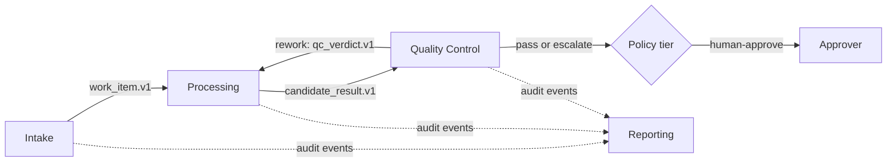

# Agent Specifications

> **Status: DRAFT design document. Not approved. Not implemented.** All implementation gates are on HOLD.
> Sources: `docs/BUSINESS_BLUEPRINT.md` (section 3), `docs/MASTER_BUILD_REGISTER.md`.
> Skill names are **placeholders until D-01**. The four agent names are founder-fixed (FC-01).

## 1. Common rules for all agents

1. Folder layout per FC-02: `agents/<agent>/AGENT.md` and `agents/<agent>/skills/<skill-name>/SKILL.md`. Proposed folder names: `intake`, `processing`, `quality-control`, `reporting`.
2. Skills are modular. Each skill documents tools, permissions, inputs, outputs, tests, and handoffs.
3. A skill's declared tool list is **advisory**; the runtime's tool gateway enforces it (register FND-16).
4. All inter-agent traffic uses a versioned, validated handoff envelope (see `TEMPLATES.md`).
5. Agents never read each other's raw conversations. They exchange envelopes and references.
6. Each run records the skill, model, and prompt versions.
7. Untrusted text (inbound content) is wrapped and never allowed to widen tools or permissions.
8. Personal data reaches a model only in masked form (see `SECURITY_PII.md`).
9. Claude Code development skills (`.claude/`) are never loaded as production skills (FC-03).

### Policy tiers (Proposed; confirm under D-08)

| Tier | Meaning | Example |
|---|---|---|
| Auto | Runs without a person | Read-only lookups |
| Assisted | Runs and is logged for review | Internal record writes |
| Human-approve | Waits for a named approver | Any customer-facing or external action (Later) |
| Manual-only | Never done by an agent | Items the founder designates (TBD) |

## 2. Intake (`agents/intake/`)

| Item | Specification |
|---|---|
| Purpose | Turn raw inbound requests into validated, masked work items |
| Inputs | Verified inbound event from the one TBD channel; tenant context |
| Outputs | `work_item.v1` (masked); audit events; `needs-human` flag when uncertain |
| Default tier | Assisted. Any customer-facing output is Human-approve (Later). |
| Model class | Small, fast, structured-output capable (TBD, D-14) |
| Limits (proposed) | Max steps per run, token cap per run, timeout: values TBD |
| Handoff | To Processing: `work_item.v1` in a handoff envelope |
| Escalation | Low confidence; missing required fields; unexpected personal data; parse failure; detector outage |
| Register rows | INT-01 to INT-09, INT-12, INT-13 |
| Steps | S-17 to S-24 |

### 2.1 Skills (placeholders)

| Skill | Inputs | Outputs | Tools (allow-list) | Data permissions | Tier | Tests |
|---|---|---|---|---|---|---|
| `classify-request` | Masked text; configured category list (TBD) | Category or `unknown`; confidence | Model gateway (structured output) | Read masked message | Auto | Labelled-set accuracy (AT-19); invalid output handling (AT-12) |
| `extract-fields` | Masked text; field definitions (TBD); category | Typed fields with per-field confidence; `not found` flags | Model gateway | Read masked message | Auto | Extraction accuracy (AT-19); injection fixtures (AT-17) |
| `validate-completeness` | Extracted fields; required-field rules (TBD) | Missing-field list; ready or `needs-human` | Rules reader (static) | Read rules | Auto | Fail-closed cases (AT-13) |
| `create-work-item` | Validated fields; findings summary | Saved `work_item.v1`; audit event | Work-item writer | Write `work_items`, audit | Assisted | Contract validation (AT-14); restart (AT-22) |

Pre-processing steps that are platform code, not skills: signature verification, deduplication, tenant context, personal-data detection, masking, vault writes.

### 2.2 Failure behavior

| Event | Behavior |
|---|---|
| Detector unavailable | Park as `needs-human`; no model call with raw text |
| Model output fails the schema after N retries (N TBD, D-04) | `needs-human` |
| Unparseable classification | Category `unknown`; `needs-human` |
| Token cap hit | Stop; `needs-human` |
| Kill switch on | No model call |

### 2.3 Component ownership

| Concern | Owner component | Origin | Verdict (register) |
|---|---|---|---|
| Signature checks | `src/channels/<channel>/verify` | Adapted from Orchester `lib/channels/slack.ts` pattern | INT-01 ADAPT |
| Duplicate protection | Idempotency store | Adapted from Orchester `idempotency.ts`, migration 0015 | FND-04 ADAPT |
| Detection and masking | Detector service + mask module | Presidio | INT-06 PENDING, INT-07 ADAPT |
| Vault | Our own | None found | INT-08 BUILD |
| Structured output | Model gateway | Vercel AI SDK / Instructor ideas | FND-17 PENDING, INT-05 BUILD |
| Skill loading | Our loader | Mastra `workspace/skills/*` pattern | FND-14 ADAPT |

## 3. Processing (`agents/processing/`)

**MVP status: stub receiver only.** The rest is design for later.

| Item | Specification |
|---|---|
| Purpose | Plan and carry out the work for a work item, producing a candidate result with evidence |
| Inputs | `work_item.v1`; tenant knowledge (TBD) |
| Outputs | `candidate_result.v1` with evidence references. Never writes to an external system directly. |
| Default tier | Assisted; side effects Human-approve |
| Handoff | To Quality Control: `candidate_result.v1` |
| Register rows | PRC-01, PRC-03 to PRC-06 |
| Steps | S-29 to S-33 |

| Skill (placeholder) | Inputs | Outputs | Tools | Tier |
|---|---|---|---|---|
| `plan-work` | Work item | Ordered steps | None | Auto |
| `execute-step` | Step; context | Step result; evidence references | Tool adapters declared per step (TBD, D-01, D-02) | Assisted; side effects Human-approve |
| `enrich-from-knowledge` | Query | Cited passages | Knowledge retrieval (tenant-scoped) | Auto |
| `assemble-result` | Step results | `candidate_result.v1` | None | Auto |

Rules: steps with side effects must be idempotent (crash recovery can repeat steps); agents never hold raw credentials.

Component ownership (all undecided): workflow engine = Orchester `lib/flows/*` (unreviewed) or Mastra `workflows/*` or our own, decided by PRC-01 and D-05; delegation = our own, borrowing Mastra `agent/scopes.ts` rule (FND-23).

## 4. Quality Control (`agents/quality-control/`)

**MVP status: not built.**

| Item | Specification |
|---|---|
| Purpose | Check candidate results against rules, facts, and personal-data policy before delivery |
| Inputs | `candidate_result.v1`; evidence; business rules (TBD) |
| Outputs | `qc_verdict.v1`: pass, rework, or escalate, with reasons. Recorded through the audit log (FND-03). |
| Permissions | Read-only on everything; writes only its verdict; cannot edit the candidate |
| Independence | Prefer a different model or prompt lineage than Processing (TBD) |
| Policy | Block or recommend; rework-loop limit: **TBD (D-06)** |
| Register rows | QC-01, QC-02 |
| Steps | S-34, S-35 |

| Skill (placeholder) | Check |
|---|---|
| `check-against-rules` | Rule compliance |
| `verify-facts` | Claims supported by evidence |
| `pii-and-policy-scan` | Personal-data policy (reuses the detector, INT-06) |
| `score-and-decide` | Combines checks into the verdict |

Human override uses the approval record (FND-07).

## 5. Reporting (`agents/reporting/`)

**MVP status: not built.**

| Item | Specification |
|---|---|
| Purpose | Build status reports and anomaly alerts from aggregated data |
| Inputs | Aggregated metric views and audit events. **No raw customer content or personal data.** |
| Outputs | `report.v1`; alerts; delivery receipts |
| Register rows | RPT-01 to RPT-04 |
| Steps | S-36 to S-39 |

| Skill (placeholder) | Purpose |
|---|---|
| `collect-metrics` | Read aggregated views |
| `build-status-report` | Produce `report.v1` |
| `detect-anomalies` | Flag deviations (thresholds TBD) |
| `deliver-report` | Send to recipients (Human-approve initially; channel TBD) |

## 6. Handoff map

| From | To | Contract | Receiver validates |
|---|---|---|---|
| Intake | Processing | `work_item.v1` | Schema, tenant match, accepted version |
| Processing | Quality Control | `candidate_result.v1` | Schema, evidence present |
| Quality Control | Processing | `qc_verdict.v1` | Loop limit (TBD, D-06) |
| Any | Reporting | Audit events (pull) | n/a |

A receiver advertises accepted contract versions; the runtime refuses a handoff on mismatch (AT-20).

## 7. Agent-level acceptance tests

| Test | Applies to | Source |
|---|---|---|
| AT-01 folder structure | all | `DEPLOYMENT_TESTING.md` |
| AT-02 skill validation | all | same |
| AT-12, AT-13, AT-14, AT-16, AT-17, AT-19, AT-20, AT-22 | Intake | same |
| Processing, QC, and Reporting acceptance tests | later | **Not yet written** |

## 8. Completeness of this document

| Part | Status |
|---|---|
| Intake specification | Complete for the proposed MVP; skill names and category/field lists TBD (D-01) |
| Processing | **Partial: design outline; tools and knowledge TBD (D-01, D-02); no acceptance tests** |
| Quality Control | **Partial: design outline; policy TBD (D-06); no acceptance tests** |
| Reporting | **Partial: design outline; thresholds and delivery channel TBD; no acceptance tests** |
