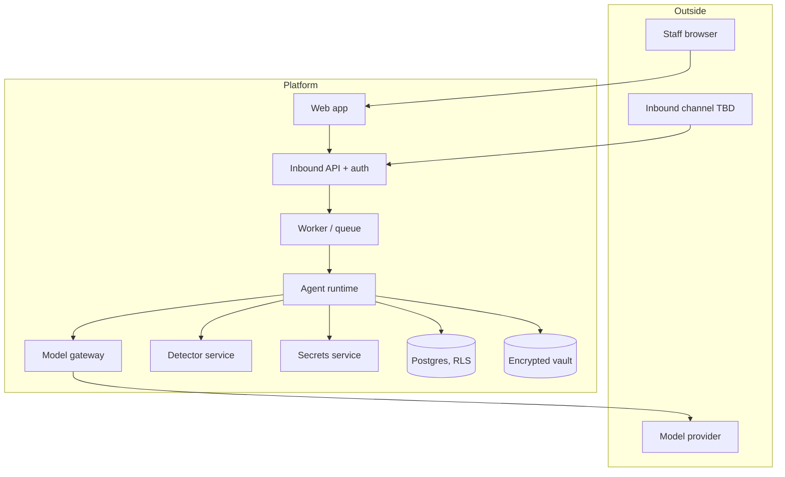
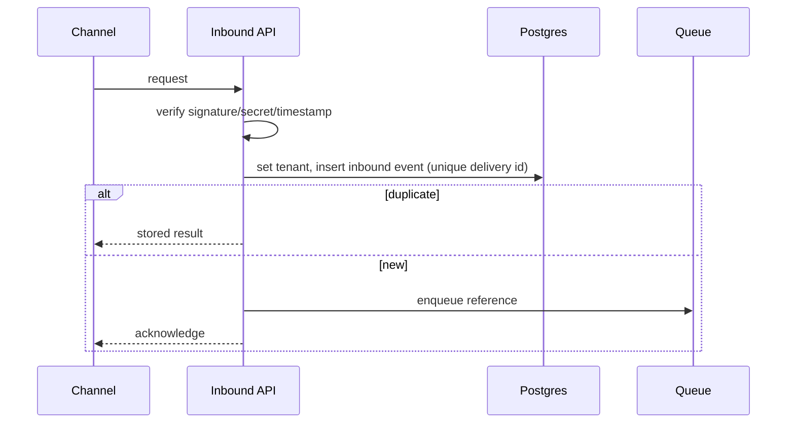
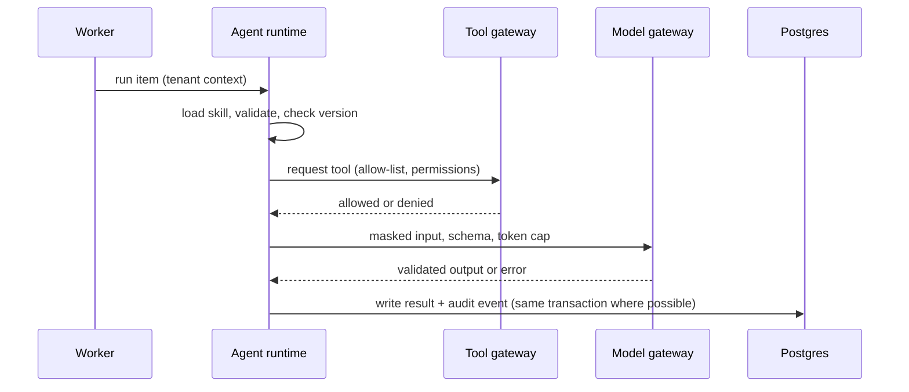

# Architecture

> **Status: DRAFT design document. Not approved. Not implemented.** No system exists. All implementation gates are on HOLD.
> Sources: `docs/BUSINESS_BLUEPRINT.md` (sections 5, 8, 11, 14, 18), `docs/MASTER_BUILD_REGISTER.md`.
> Stack is **Proposed, D-14** (TypeScript service layer, Postgres, a Python detector service). Cloud provider and region are **TBD (D-03, D-11)**. Customer integrations are **TBD (D-02)**.

## 1. Architectural goals

1. Tenant isolation enforced in the database, not only in code.
2. Personal data masked before any model call; raw values only in an encrypted vault.
3. Every step traceable by one correlation id and recorded in a tamper-evident log.
4. Four agents with explicit, versioned contracts between them.
5. Smallest runnable step first (the Intake pilot).
6. Borrow patterns from Orchester and Mastra; do not depend on unreviewed or enterprise-licensed code.

## 2. System context

Trust boundaries: Outside ⟷ Platform (untrusted input); Platform ⟷ Model provider (masked text only); Platform ⟷ Detector (internal, authenticated); Staff ⟷ Platform (tenant-scoped).

## 3. Containers (proposed)

| Container | Responsibility | Runtime | Notes |
|---|---|---|---|
| Inbound API | Verify, deduplicate, set tenant, acknowledge, enqueue | TypeScript | No model calls in the request path |
| Web app | Read-only work-item list (MVP) | TypeScript / React (TBD, D-10) | Server enforces permissions |
| Worker | Pull queued items, run agents | TypeScript | Pattern from Orchester `apps/web/worker/index.ts` (V1), but as a standalone package with graceful shutdown |
| Agent runtime | Load skills; run Intake skills; enforce tool allow-list | TypeScript | Skill loader pattern from Mastra `workspace/skills/*` (V1) |
| Model gateway | Structured output, bounded retry, token cap, metering | TypeScript | Library choice PENDING (FND-17) |
| Detector service | Detect personal data | Python (Presidio) | Private network; auth in front |
| Secrets service | Keys and signing secrets | Managed (TBD) | |
| Postgres | Tenant data, audit, queue (pg-boss style, TBD) | Postgres | Restricted runtime role |
| Vault | Encrypted raw values | Postgres table with per-tenant keys (proposed) | Separate read role |

## 4. Component ownership matrix

"Ownership" shows which component supplies the capability and where the design came from. No code has been copied, installed, or run.

| Capability | Our component (proposed file area) | Orchester reference | Mastra reference | Other reference | Register row | Verdict |
|---|---|---|---|---|---|---|
| Tenant wall | `src/tenancy/*`, migrations | `apps/web/lib/tenant/context.ts`, migrations 0006, 0007, 0009 (V1) | n/a | n/a | FND-02 | ADAPT |
| Query-scoping CI guard | `ci/*` | README states CI invariants (V2) | n/a | n/a | FND-25 | BUILD |
| Audit chain | `src/audit/*` | `apps/web/lib/audit/chain.ts` (V1) | n/a | n/a | FND-03 | ADAPT |
| Idempotency | `src/idempotency/*` | `packages/db/src/schema/idempotency.ts`, migration 0015 (V1) | n/a | n/a | FND-04 | ADAPT |
| Signed inbound | `src/channels/*` | `lib/channels/slack.ts`, `telegram.ts` (V1) | n/a | n/a | INT-01 | ADAPT |
| Widget guard / allowlist | `src/channels/*` | `widget-guard.ts`, `allowlist.ts` (V1) | n/a | n/a | INT-02 | ADAPT |
| Inbound route and router ideas | `src/api/*` | Telegram route, `router.ts` (V1) | n/a | n/a | INT-03, INT-04 | BUILD (borrow ideas) |
| Skill loading and validation | `src/skills/*` | n/a | `workspace/skills/{schemas,workspace-skills,tools}.ts` (V1) | `agentskills/agentskills` | FND-14 | ADAPT |
| Model gateway | `src/model/*` | n/a | n/a | Vercel AI SDK; Instructor `retry.py` | FND-17 | PENDING |
| Detection | Detector service | n/a | n/a | Presidio | INT-06 | PENDING |
| Masking | `src/pii/mask` | n/a | n/a | Presidio operators | INT-07 | ADAPT |
| Vault | `src/pii/vault` | n/a | n/a | none found | INT-08 | BUILD |
| Labels and fail-closed | `src/pii/policy` | n/a | n/a | AWS sample (design) | INT-09 | ADAPT (design) |
| Job runner | Worker package | `apps/web/worker/index.ts` (V1) | n/a | n/a | FND-08 | BUILD |
| Pause/resume (Later) | Undecided | n/a | `agent/agent.ts`, `workflows/*`, `storage/*`, `stores/pg` (V1 partly) | n/a | FND-05 | PENDING |
| Approver identity (Later) | Our own | approval page (V3) | FGA is `ee` (not used) | n/a | FND-07 | BUILD |
| Run scopes (Later) | Our own | n/a | `agent/scopes.ts` (V1) | n/a | FND-23 | BUILD (idea) |
| Tool approval flags (Later) | Tool gateway | n/a | `tools/toolchecks.ts`, `hitl.md` (V1) | n/a | FND-24 | ADAPT |
| Spend/quota (Later) | `src/billing/*` | `lib/billing/*` (V3) | n/a | n/a | FND-09 | PENDING |
| Export/delete (Later) | `src/gdpr/*` | `lib/gdpr/*`, `tenant/hard-delete-job.ts` (V3) | n/a | n/a | FND-13 | ADAPT |

Never used: Mastra `ee/` code (FND-06), Orchester memory service (Mnemosyne), Orchester UI pages (UI-05), AWS sample infrastructure (INT-11).

## 5. Key runtime sequences

### 5.1 Inbound (see `USER_FLOWS.md` F-01)

### 5.2 Skill execution

### 5.3 Personal-data path

Detector receives raw text over an authenticated internal call; returns findings; the vault stores raw values under per-tenant keys; only masked text proceeds. See `SECURITY_PII.md`.

## 6. Cross-cutting design

| Concern | Decision | Document |
|---|---|---|
| Identity and sessions | Managed auth (TBD) with MFA for admins (TBD) | `SECURITY_PII.md` |
| Secrets | Secrets service; no secrets in code, logs, or the database | `SECURITY_PII.md` |
| Observability | One correlation id; traces, metrics, redacted logs | `OBSERVABILITY.md`, `DIAGNOSTIC_LOGGING.md` |
| Cost control | Per-run token cap; global kill switch; tenant caps Later | `PRD.md` |
| Versioning | Skills, contracts, prompts, models versioned and recorded on every run | `AGENT_SPECS.md` |
| Idempotency | Delivery id, workspace-scoped keys, idempotent steps | `DATABASE_DESIGN.md` |

## 7. Failure modes

| Failure | Effect | Design response |
|---|---|---|
| Detector down | Cannot mask | Park item `needs-human`; no model call |
| Model provider down | Cannot classify | Retry within cap; then `needs-human` |
| Database down | Cannot persist | Reject inbound with provider-appropriate response |
| Queue backlog | Delay | Alert; autoscale TBD |
| Worker crash mid-run | Partial work | Item completes once or retries without duplicates (AT-22) |
| Audit chain mismatch | Possible tampering | Alert; investigate (AT-15) |
| Secrets service down | Cannot verify or decrypt | Fail closed |
| Unexpected personal data in output | Policy breach | Block; flag; investigate |

## 8. Deployment topology (proposed, not authorized)

| Environment | Data | Notes |
|---|---|---|
| Local | Synthetic only | Developer machines |
| Staging | Synthetic only | Same topology as production |
| Production | Not before founder approval | Cloud provider TBD |

Detector and database sit on private networks; only the inbound API and web app are public. Details in `DEPLOYMENT_TESTING.md`.

## 9. Architecture decisions to record (ADRs, proposed)

| ADR | Topic | Depends on |
|---|---|---|
| ADR-A | Language and database (D-14) | Founder |
| ADR-B | Row-level security model and roles | FND-02 |
| ADR-C | Detector as a separate service; hosting | D-03 |
| ADR-D | Model gateway library and retry policy | FND-17, D-04 |
| ADR-E | Pause/resume: adopt Mastra core or build | D-05, FND-06 |
| ADR-F | Skill contract sidecar format | D-07 |
| ADR-G | Vault and key management | FND-10 |

## 10. Capacity and performance

Targets are **TBD**. No load profile exists because the vertical and volumes are undecided.

## 11. Completeness of this document

| Part | Status |
|---|---|
| Context, containers, ownership matrix, sequences, failure modes for the MVP | Complete as a proposal |
| Processing, QC, Reporting runtime design | **Outline only** |
| Capacity, availability, cost model | **Incomplete: TBD** |
| Cloud provider, networking, infrastructure as code | **Incomplete: TBD (D-03, D-11)** |
| Verification of reference components | **Partial: see register verification levels (several V3/V4)** |
