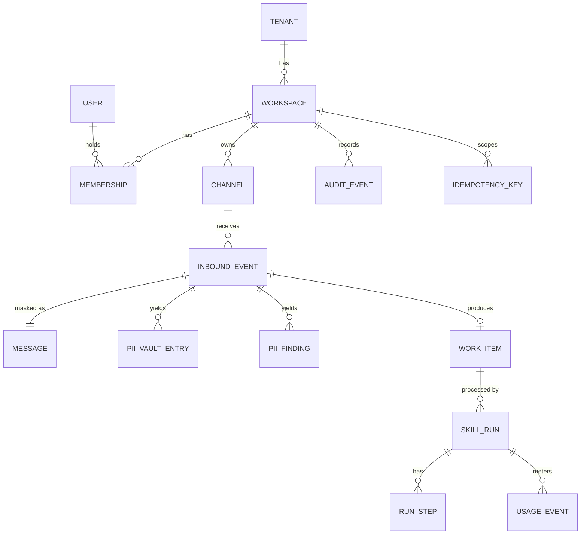

# Database Design

> **Status: DRAFT design document. Not approved. Not implemented.** No schema, migration, or database exists. All implementation gates are on HOLD.
> Sources: `docs/BUSINESS_BLUEPRINT.md` (section 6), `docs/MASTER_BUILD_REGISTER.md` (FND-02, FND-03, FND-04, FND-22, INT-08).
> The database engine (Postgres) is **Proposed, D-14**. Retention periods are **TBD (D-11)**. Vertical-specific columns are **TBD (D-01)**.
> Orchester schema files are cited as references only (V3 unless noted); nothing was copied.

## 1. Principles

1. Every tenant-owned table has `workspace_id` and **forced row-level security**.
2. The application connects as a restricted role with no bypass; migrations run as a separate role. A boot-time check refuses a superuser or bypass-capable connection.
3. Tenant context is set per transaction (`SET LOCAL` pattern) and **fails closed** when missing.
4. Raw personal data exists only in the vault table, encrypted with per-tenant keys.
5. Audit rows are append-only for the application role and hash-chained.
6. No message body or raw personal data in any table except `pii_vault_entries` (encrypted).
7. Migrations are forward-only; each has a documented rollback plan (method TBD).

## 2. Entity-relationship diagram (MVP)

## 3. MVP tables

Column lists are proposals. Types are described in words. "RLS" means forced row-level security keyed on `workspace_id`.

### 3.1 Tenancy and identity

| Table | Columns (proposed) | Keys and constraints | RLS | Reference |
|---|---|---|---|---|
| `tenants` | id, name, status, created_at | PK id | No (platform table; app role read-only) | Orchester `core`/`orgs` schemas (V3) |
| `workspaces` | id, tenant_id, name, status, created_at | PK id; FK tenant | Yes (own row) | Orchester `workspaces` schema (V3) |
| `users` | id, email (TBD handling), auth_subject, created_at | PK id; unique auth_subject | Platform table | Orchester `auth` schema (V3) |
| `memberships` | id, workspace_id, user_id, role, created_at | PK id; unique (workspace_id, user_id) | Yes | Orchester `workspaces` schema (V3) |

Roles: `customer_admin`, `customer_staff`, `platform_admin` (proposed, D-08).

### 3.2 Channels and inbound

| Table | Columns | Keys and constraints | RLS | Reference |
|---|---|---|---|---|
| `channels` | id, workspace_id, type (TBD, D-02), status, secret_ref (pointer to secrets service, never the secret), config (non-secret) | PK id; FK workspace | Yes | Orchester `integrations` schema (V3) |
| `inbound_events` | id, workspace_id, channel_id, delivery_id, received_at, verification_result, payload_ref (no body in this table), status | PK id; unique (workspace_id, channel_id, delivery_id) | Yes | Orchester Telegram route (V1) for what to avoid |
| `idempotency_keys` | workspace_id, scope, key, request_hash, response_ref, created_at, expires_at | PK (workspace_id, scope, key) | Yes | Orchester `idempotency.ts` (V1) and migration 0015 (V1: key includes workspace) |

### 3.3 Messages, personal data, work items

| Table | Columns | Keys and constraints | RLS | Notes |
|---|---|---|---|---|
| `messages` | id, workspace_id, inbound_event_id, masked_text, token_count, created_at | PK id; unique inbound_event_id | Yes | Masked only |
| `pii_findings` | id, workspace_id, inbound_event_id, entity_type, count, detector_version, created_at | PK id | Yes | Types and counts only; no offsets or values |
| `pii_vault_entries` | id, workspace_id, inbound_event_id, token_id, ciphertext, key_id, entity_type, created_at, delete_after (TBD) | PK id; unique (workspace_id, token_id) | Yes; read path restricted to a dedicated role | No plaintext column |
| `work_items` | id, workspace_id, inbound_event_id, category, fields (structured, masked), missing_fields, status, reasons, contract_version, created_at | PK id; unique inbound_event_id; check status in (`ready`, `needs-human`, ...) | Yes | Matches `work_item.v1` |

### 3.4 Runs, usage, audit

| Table | Columns | Keys and constraints | RLS | Reference |
|---|---|---|---|---|
| `skill_runs` | id, workspace_id, work_item_id, agent, skill, skill_version, model, prompt_version, status, started_at, ended_at, correlation_id | PK id | Yes | Mastra snapshot idea (V1), not copied |
| `run_steps` | id, workspace_id, skill_run_id, seq, tool, input_ref, output_ref, status, error_code | PK id; unique (skill_run_id, seq) | Yes | No bodies; references only |
| `usage_events` | id, workspace_id, skill_run_id, model, tokens_in, tokens_out, cost_estimate, created_at | PK id | Yes | Orchester `usage_events` (README, V2) |
| `audit_events` | id, workspace_id, seq, actor_kind, actor_id, action, target_type, target_id, meta (masked), created_at, payload_hash, chain_hash | PK id; unique (workspace_id, seq); append-only to app role | Yes | Orchester `audit/chain.ts` (V1): hash over canonical fields and previous hash |
| `skill_registry` | name, agent, version, content_hash, loaded_at, status | PK (name, version) | Platform table | Mastra `publish.ts` hashing idea (V1) |

## 4. Later tables (outline only)

| Table | Purpose | Reference |
|---|---|---|
| `approvals` | Approver, role, decision, reason, expiry, action reference | None (FND-07) |
| `workflow_snapshots`, `run_owners` | Pause/resume state and leases, with workspace_id added | Mastra `stores/pg` (V1), if D-05 adopts |
| `candidate_results`, `qc_verdicts` | Processing and QC outputs | n/a |
| `knowledge_docs`, `knowledge_chunks` | Tenant knowledge and vectors | Orchester `knowledge` schema (V3) |
| `reports` | Reporting outputs | n/a |
| `subscriptions`, `credit_ledger` | Billing (D-12) | Orchester `lib/billing/*` (V3) |
| `data_requests` | Export and deletion tracking | Orchester `lib/gdpr/*` (V3) |
| `api_keys` | Scoped integration keys (hashed) | Orchester `lib/api-auth/*` (V3) |

## 5. Row-level security design

| Rule | Detail | Test |
|---|---|---|
| Tenant setting | Each transaction sets the current workspace; helper returns null when unset | AT-03 |
| Policies | For each table: select, insert, update, delete allowed only where `workspace_id` equals the current workspace; insert/update also check the same value | AT-03, AT-04 |
| Fail closed | Unset or empty setting → no rows, no writes | AT-03 |
| Role separation | `app_runtime` (restricted), `migrator` (owner), `audit_reader` (read-only), `vault_reader` (narrow) | AT-03, AT-10 |
| No bypass | The runtime role has no bypass attribute; boot check enforces | AT-03 |
| Cross-tenant jobs | Run as a dedicated role with explicit, audited bypass; each use writes an audit event (the Orchester `withCrossTenantAdmin` pattern, V1 in the Telegram route and worker, is the reference; its risk is noted in the register) | New test required |
| Audit protection | `app_runtime` cannot update or delete `audit_events`; **future audit tables must repeat this** (Orchester migration 0007 pitfall) | AT-15 |
| Passwords | No credentials in migrations (Orchester migration 0007 hardcodes dev passwords: do not copy) | CI secret scan |

Orchester evidence: `apps/web/lib/tenant/context.ts` (V1), migrations 0006, 0007, 0009 (V1). Migrations 0008 and 0010, which hold the actual policies, **have not been read (V4)**.

## 6. Indexes (proposed)

| Table | Index | Purpose |
|---|---|---|
| `inbound_events` | (workspace_id, channel_id, delivery_id) unique | Duplicate protection |
| `work_items` | (workspace_id, status, created_at) | Staff list filters |
| `work_items` | (workspace_id, category) | Category filter |
| `audit_events` | (workspace_id, seq) unique | Chain order |
| `usage_events` | (workspace_id, created_at) | Cost queries |
| `skill_runs` | (workspace_id, correlation_id) | Trace lookup |

## 7. Migration order (proposed; matches the file sequence in the blueprint)

1. Roles and tenancy tables.
2. Row-level security helper and policies.
3. Audit events and chain.
4. Idempotency keys.
5. Vault.
6. Inbound events, messages, findings, work items, runs, usage.

Orchester's ~64 migrations are a checklist for RLS patterns only (register FND-22). Skip its memory-service migrations (0016 to 0048).

## 8. Data lifecycle

| Data | Retention | Deletion |
|---|---|---|
| Masked messages, work items | TBD (D-11) | By customer request (Later, FND-13) |
| Vault entries | TBD (D-11); shortest practical | Delete or crypto-shred; method TBD |
| Audit events | TBD; anchored chain head kept | Not deletable by the app role |
| Usage events | TBD | Aggregation then purge, TBD |
| Logs | TBD (see `DIAGNOSTIC_LOGGING.md`) | TBD |

## 9. Database tests

| Test | Covers |
|---|---|
| AT-03, AT-04 | Tenant isolation, including via inbound path |
| AT-06 | Idempotency |
| AT-10 | Vault has no plaintext at rest |
| AT-15 | Audit chain tamper and concurrency |
| AT-22 | Restart without duplicates |

## 10. Completeness of this document

| Part | Status |
|---|---|
| MVP tables, relationships, RLS rules, indexes, migration order | Complete as a proposal for the MVP |
| Column types and exact constraints | **Incomplete: described in words; to be fixed in the implementation phase** |
| Vertical-specific fields and categories | **Not started (D-01)** |
| Later tables | **Outline only** |
| Retention and deletion method | **Incomplete: TBD (D-11)** |
| Orchester policy migrations 0008/0010 | **Not read; RLS policy shape is unverified** |
