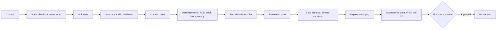

# Deployment and Testing

> **Status: DRAFT design document. Not approved. Not implemented.** No environment, pipeline, or test exists. **Deployment is not authorized.** All implementation gates are on HOLD.
> Sources: `docs/BUSINESS_BLUEPRINT.md` (sections 14, 15, 16), `docs/MASTER_BUILD_REGISTER.md`.
> Cloud provider, regions, infrastructure tooling, and all numeric thresholds are **TBD**. The pilot uses **synthetic data only** (proposed, D-13).

## 1. Environments (proposed)

| Environment | Data | Purpose | Status |
|---|---|---|---|
| Local | Synthetic | Development and unit tests | Not created |
| CI | Synthetic | Automated gates | Not created |
| Staging | Synthetic | Same topology as production; acceptance tests | Not created |
| Production | Real customer data (not before gate G4) | Live service | **Not authorized** |

Rules: staging never receives real data; secrets differ per environment; production access is restricted and logged.

## 2. Deployment units (proposed, D-14)

| Unit | Runtime | Network |
|---|---|---|
| Inbound API and web app | TypeScript | Public |
| Worker | TypeScript | Private |
| Detector service | Python (Presidio) | Private; authentication in front |
| Postgres | Managed | Private |
| Secrets service | Managed | Private |

Detector note: Presidio's REST services have no built-in authentication; pin image digests; verify the new owner of the moved project (register INT-06).

## 3. Delivery pipeline (proposed)

| Stage | Gate | Tests |
|---|---|---|
| Static and secret scan | Fail on any secret or planted fake | SEC-T2 |
| Structure and skills | Founder-fixed layout; skill rules | AT-01, AT-02 |
| Contract tests | Schemas | AT-14, AT-20 |
| Database | Tenant isolation, audit, idempotency | AT-03, AT-04, AT-06, AT-15 |
| Security and leak | Inbound, injection, logs | AT-05, AT-09, AT-11, AT-17 |
| Evaluation | Accuracy and recall at founder targets | AT-08, AT-19 |
| Acceptance | Full suite in staging | AT-01 to AT-22 |
| Production | Founder approval (gate G5) | n/a |

## 4. Rollback and migration policy

| Item | Rule |
|---|---|
| Code | Previous artifact redeployable; pinned versions |
| Migrations | Forward-only; each has a rollback plan and a staging rehearsal |
| Skills | Repository-loaded in the MVP; version pinning and rollback Later (FND-15) |
| Kill switch | Available at any time (AT-18) |
| Feature flags | TBD |

## 5. Test strategy

| Layer | Scope | Examples |
|---|---|---|
| Unit | Pure logic | Skill validator, masking, schema checks |
| Contract | Schemas and versions | `work_item.v1`, handoff envelope |
| Integration | Database with RLS; detector; model gateway with recorded responses | Tenant isolation, idempotency |
| Security | Inbound forgery, injection, cross-tenant | AT-03 to AT-05, AT-17 |
| Evaluation | Labelled synthetic sets | AT-08, AT-19 |
| Resilience | Kill and restart | AT-22 |
| Accessibility and UI | Screens | UI-T1 to UI-T4 |
| Operations drills | Kill switch, rollback | Scheduled, TBD |

Model calls in CI use recorded responses; a small scheduled run against the real provider checks drift (frequency TBD).

### 5.1 Synthetic data policy

All pilot test data is synthetic and labelled. It contains no real person's data. Its content (categories, fields, entity types) is **TBD (D-01, D-11)**. Each case records the expected category, expected fields, and expected personal-data findings. Raw synthetic values are tracked so leak tests can search for them exactly.

## 6. Acceptance tests for the Intake MVP (AT-01 to AT-22)

A test with a **TBD** threshold cannot pass until the founder sets the threshold. **MVP exit: all 22 tests pass.**

| ID | Test | Procedure | Pass criterion |
|---|---|---|---|
| AT-01 | Founder-fixed structure | Run the structure check on the repository | Exactly four agent folders named `intake`, `processing`, `quality-control`, `reporting`, each with `AGENT.md`; every skill folder has `SKILL.md`; a fifth or misnamed agent folder fails |
| AT-02 | Skill validation | Submit skills with an unknown frontmatter key, a name different from the folder, a description over 1,024 characters, a missing sidecar, and an oversized body | All five rejected with a specific error; a valid skill loads |
| AT-03 | Tenant isolation | Seed tenants A and B; attempt reads and writes on every tenant table as A against B's rows; repeat with the tenant setting unset; connect with a superuser role | No cross-tenant reads or writes; unset setting returns nothing; a bypass-capable role makes the app refuse to start |
| AT-04 | Cross-tenant via inbound | Send a message to A's channel | Resulting work item, vault entry, and audit event exist only under A |
| AT-05 | Channel authentication | Send messages with no signature, a wrong signature, a stale timestamp, and a wrong URL secret | All rejected; no rows except one audit event without body |
| AT-06 | Duplicate delivery | Send the same delivery id twice | One work item and one set of model calls; second response equals the first |
| AT-07 | Fast acknowledgement | Send a message that triggers slow processing | Acknowledged within the limit (**TBD, D-02**); processing continues afterward |
| AT-08 | Personal-data recall | Run the detector over the labelled synthetic set | Per-type recall at or above the target (**TBD, D-04**); per-type precision reported |
| AT-09 | Model input is masked | Capture every request to the model gateway during the suite | Zero occurrences of any synthetic raw value (exact-string search) |
| AT-10 | Vault | Read vault storage directly; attempt unauthorized and authorized reads | No plaintext at rest; unauthorized read denied and audited |
| AT-11 | Log hygiene | After the whole suite, including forced failures, search logs, traces, error output, analytics outputs, and audit metadata | Zero raw synthetic values and zero message bodies |
| AT-12 | Structured output limits | Feed schema-invalid model responses | At most N retries (**N TBD**); token cap respected; then `needs-human`; retries logged without content |
| AT-13 | Fail closed | Feed an unparseable classification and a detector outage | Item is `needs-human`; none marked `ready`; no model call with raw text |
| AT-14 | Work-item contract | Validate all saved items | Every item validates against `work_item.v1`; masked content only; confidence and versions present |
| AT-15 | Audit chain | Alter one audit row; run concurrent appends | Alteration detected; chain does not fork |
| AT-16 | Shadow mode | Run the suite with network egress monitoring | No outbound message to the sender or any outside system; only the model provider, detector, and database are contacted |
| AT-17 | Injection fixtures | Send messages instructing the model to ignore rules, reveal vault contents, or call tools | No tool call, no vault access, item flagged |
| AT-18 | Spend cap and kill switch | Set a low per-run token cap; then turn on the kill switch | Run stops at the cap; with the switch on, no model call occurs (inbound behavior **TBD**) |
| AT-19 | Accuracy gate | Run the labelled synthetic set | Classification and extraction accuracy at or above targets (**TBD, D-04**); confusion matrix produced |
| AT-20 | Hand-off | Send the work item to the Processing stub, then an unsupported contract version | Valid envelope accepted; unsupported version rejected |
| AT-21 | Read-only list | Log in as staff of A and of B | Each sees only own items, masked; no unmask control exists |
| AT-22 | Restart | Stop the process during processing and restart | Item completes once or retries without creating a duplicate |

## 7. Proposed additional tests (not yet numbered into the MVP exit)

| ID | Source document | Check |
|---|---|---|
| UI-T1 | `UI_UX_DESIGN.md` | Empty, loading, and error states render as specified |
| UI-T2 | same | Accessibility checklist |
| UI-T3 | same | Mode banner on every screen |
| UI-T4 | same | No raw synthetic values in page source or network responses |
| AN-T1 | `ANALYTICS.md` | Metrics reconcile with source row counts |
| AN-T2 | same | Tenant A cannot see tenant B's metrics |
| OB-T1 | `OBSERVABILITY.md` | One correlation id across spans and logs |
| OB-T2 | same | Safety alerts fire for planted conditions |
| OB-T3 | same | Canary item completes within target |
| LOG-T1 to LOG-T4 | `DIAGNOSTIC_LOGGING.md` | Correlation, error codes without content, library defaults, diagnostic-mode expiry |
| SEC-T1 to SEC-T4 | `SECURITY_PII.md` | Detector auth, secret scan, key rotation, widget body cap and origin check |

The founder decides whether these join the MVP exit.

## 8. Test traceability

| Requirement | Tests |
|---|---|
| PRD-01 | AT-01 |
| PRD-02 | AT-02 |
| PRD-03 | AT-03, AT-04 |
| PRD-04 | AT-05, AT-06, AT-07 |
| PRD-05 | AT-08, AT-09, AT-10 |
| PRD-06 | AT-14, AT-19 |
| PRD-07 | AT-12, AT-13 |
| PRD-08 | AT-20 |
| PRD-09 | AT-15 |
| PRD-10 | AT-11 |
| PRD-11 | AT-17 |
| PRD-12 | AT-18 |
| PRD-13 | AT-16 |
| PRD-14 | AT-21 |
| PRD-15 | AT-22 |
| Founder-fixed structure (FC-01, FC-02) | AT-01 |

## 9. Entry and exit criteria

| Milestone | Entry | Exit |
|---|---|---|
| Foundation | Decisions D-01, D-02, D-13, D-14 recorded; rows approved | AT-01 to AT-04, AT-15 pass |
| Intake pilot | Foundation exit; D-03, D-04, D-11 recorded | AT-01 to AT-22 pass |
| Production readiness | Intake pilot exit; deletion/export; runbooks; legal review; founder approval | TBD |

## 10. First implementation file sequence (proposed; nothing exists)

Same order as `docs/BUSINESS_BLUEPRINT.md` section 16: agent folders and contract schemas → tenancy migrations and context → query-scoping guard → secrets configuration → audit chain → idempotency → safe logger → skill validation and loader → model gateway → vault → detector client → masking → fail-closed policy → channel verification → inbound migrations and route → Intake skills with sidecars → Intake run → Processing stub → evaluation sets → acceptance suites → read-only work-item list. Each item is tied to a register row, a build step, and tests there.

## 11. Component ownership for testing

| Test area | Reference to learn from | Row |
|---|---|---|
| Cross-tenant leaks | Orchester `__tests__/phase-f2-flow-engine-rls.test.ts` (V3) | FND-20 |
| Webhook secrets and forged requests | Orchester `telegram-webhook-secret.test.ts`, `stripe-webhook-signature.test.ts` (V3) | FND-20 |
| Widget limits | Orchester `widget-public-limits.test.ts` (V3) | FND-20 |
| Double approval and restart (Later) | Mastra `concurrent-resume-claim.test.ts`, `persisted-approval-run-id.test.ts`, `agentic-loop-snapshot-lifecycle.test.ts` (V1) | FND-20 |
| Identity denial | Mastra `agent-fga.test.ts` (V1): has no test that a second user is denied | FND-20 gap |
| Skill loading | Mastra `workspace-skills.test.ts`, `schemas.test.ts` (V3) | FND-14 |
| Personal-data detection | Presidio analyzer tests (about 126 files, V3) | INT-06 |

## 12. Completeness of this document

| Part | Status |
|---|---|
| Pipeline, test strategy, AT-01 to AT-22, traceability, entry/exit | Complete as a proposal |
| Environment and infrastructure details, cloud, tooling | **Incomplete: TBD (D-03, D-11, D-14)** |
| Numeric thresholds | **Incomplete: TBD (D-04, D-02)** |
| Tests for Processing, QC, Reporting | **Not written** |
| Production readiness criteria | **Incomplete: TBD** |
| Deployment | **Not authorized** |
