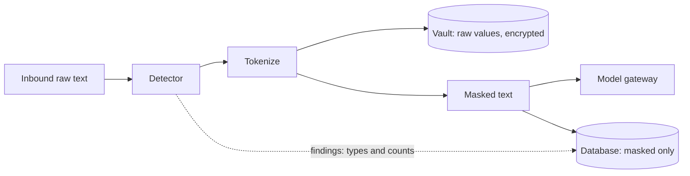

# Security and Personal-Data (PII) Design

> **Status: DRAFT design document. Not approved. Not implemented.** No control described here exists yet. All implementation gates are on HOLD.
> Sources: `docs/BUSINESS_BLUEPRINT.md` (section 11), `docs/MASTER_BUILD_REGISTER.md` (FND-02 to FND-13, FND-25, INT-06 to INT-11, R-002, R-003).
> Legal and compliance scope (GDPR, CCPA, sector rules), retention, personal-data types, regions: **TBD (D-11)**. **No legal review has been done.** Whether any cloud check is allowed: **TBD (D-03)**.

## 1. Security objectives

1. No tenant can read or affect another tenant's data.
2. Raw personal data reaches only the encrypted vault; no model provider, log, analytics store, or UI receives it in the pilot.
3. Every state change is attributable and tamper-evident.
4. Inbound traffic is authenticated, deduplicated, and rate-limited.
5. Failures stop work and ask a person rather than guess (fail closed).
6. Agents act only through declared, enforced permissions.

## 2. Data classification

| Class | Examples | Allowed locations | Prohibited locations |
|---|---|---|---|
| C1 Raw personal data | Identifiers, contact details, financial details (types TBD, D-11) | Vault (encrypted); detector (in memory, in transit) | Model providers, logs, analytics, UI, queue payloads, backups unencrypted |
| C2 Masked content | Message text with tokens; extracted fields | Database, model providers, UI | Public locations |
| C3 Secrets | Signing secrets, API keys, encryption keys | Secrets service | Code, logs, database plaintext, UI |
| C4 Operational metadata | Ids, counts, timings, versions | Anywhere inside the platform | Public locations |

The old GitHub token (register section 13) is a C3 secret treated as compromised until the founder confirms revocation.

## 3. Personal-data lifecycle (pilot)

| Stage | Control | Test |
|---|---|---|
| Receive | Verify, deduplicate, tenant context | AT-05, AT-06, AT-03 |
| Detect | Detector behind authentication; recall measured on a labelled synthetic set | AT-08 |
| Tokenize | Stable tokens per entity within a tenant; two different people never share a token | AT-09 (extended) |
| Store | Per-tenant keys; no plaintext at rest | AT-10 |
| Use | Models and UI see masked text only | AT-09, AT-21 |
| Log | Bodies and raw values never logged | AT-11 |
| Delete | Export and deletion across all stores (Later; needed before real customer data) | PRD-22 |

## 4. Controls

### 4.1 Tenant isolation (FND-02, FND-25)

| Control | Detail | Reference |
|---|---|---|
| Forced row-level security | On every tenant table; policies on `workspace_id` | Orchester migrations 0006, 0007, 0009 (V1); 0008 and 0010 unread |
| Restricted runtime role | No superuser, no bypass | Orchester migration 0007 (V1) |
| Per-transaction tenant setting | Transaction-local; fails closed when unset | Orchester `tenant/context.ts` (V1) |
| Boot check | Refuse to start under a bypass-capable role | Orchester `db-role-check.ts` (V3) |
| CI guard | Fail the build on unscoped queries | Orchester README (V2) |
| Cross-tenant jobs | Dedicated role, explicit, audited | Orchester pattern (risk noted) |

Known Orchester weaknesses to avoid: hardcoded dev passwords in migration 0007; `cron_admin` can edit audit tables; future audit tables may be writable unless the revoke is repeated; lookups before the tenant lock run under an elevated role; webhooks use a cross-tenant lookup.

### 4.2 Inbound hardening (INT-01, INT-02, INT-03)

| Control | Detail | Reference |
|---|---|---|
| Signed requests with replay window | Constant-time compare; stale timestamps rejected | Orchester `slack.ts` (V1) |
| Secret header separate from URL secret | URL secrets leak into logs | Orchester `telegram.ts` (V1) |
| Deny-by-default sender allowlist | Explicit "open" switch required | Orchester `allowlist.ts` (V1) |
| Rate limits per sender and per channel | A forged address header defeats per-sender limits; channel limit is the backstop | Orchester `widget-guard.ts` (V1); `lib/rate-limit` unread |
| Body size cap before parsing | Missing in Orchester widget guard | gap to fill |
| Origin check for browser widgets | Orchester allows any origin | gap to fill |
| Fast acknowledgement; work on the queue | Orchester holds the connection | Telegram route (V1) |
| Duplicate protection | Delivery id plus workspace-scoped key | `idempotency.ts`, migration 0015 (V1) |

### 4.3 Personal-data protection (INT-06 to INT-09)

| Control | Detail | Source and caveat |
|---|---|---|
| Detector | Presidio (patterns, checksums, context, name model); 50+ entity types across about 18 countries; English by default | MIT; **no guarantee of finding everything**; REST API has no built-in auth |
| Second layer | Optional cloud guardrail; only if D-03 allows | AWS sample; MIT-0; costs unknown at our scale |
| Masking | Stable tokens; `replace` alone gives the same placeholder for everyone | Presidio docs (V1) |
| Fail-closed labels | Unknown or unclassifiable content gets the most restrictive treatment | AWS sample design (V1) |
| No LLM-only detection | Misses silently and sends raw text to a provider | AWS sample weakness (V1) |
| Detector outage | Park the item; never fall back to unmasked model calls | AT-13 |
| Presidio supply chain | Project moved organizations and registries; pin versions and image digests; verify the new owner | Register INT-06 |

### 4.4 Vault and keys (INT-08, FND-10)

| Control | Detail |
|---|---|
| Encryption | Per-tenant data keys, wrapped by a managed key service (TBD) |
| Access | A dedicated narrow database role; no unmask path in the pilot |
| Audit | Every read, allowed or denied, writes an audit event |
| Rotation | Procedure TBD; tested in staging |
| Deletion | Delete or crypto-shred (method TBD) |

### 4.5 Approvals and identity (Later; FND-07, FND-23, FND-24)

| Control | Detail |
|---|---|
| Named approver | Identity, role, workspace, and the exact action are checked by our API before any resume |
| Record | Approver, decision, reason, time, expiry, evidence reference |
| Expiry | Pending approvals expire (period TBD) |
| One decision | Atomic claim; a second decider gets "already resolved" |
| Never trust a run id alone | Mastra's identity check is optional and enterprise-folder code; it does nothing without a provider |
| Mastra `ee/` code | Not used (FND-06) |

### 4.6 Agent and skill security

| Control | Detail |
|---|---|
| Tool allow-list enforced by a gateway | `allowed-tools` in `SKILL.md` is advisory only |
| Untrusted-input wrapper | Inbound text never widens tools or permissions |
| Injection fixtures in CI | AT-17 |
| Skill validation | Reject unknown keys, mismatched names, oversize bodies (Mastra reads show no size cap) |
| Signed, versioned skill bundles | Later (FND-15) |
| Sandboxing for skill scripts | Not needed in the pilot (skills contain no executable scripts); Later TBD |

### 4.7 Audit (FND-03)

Hash chain over canonical fields (Orchester `audit/chain.ts`, V1). Needs: serialized appends; handling of odd value types; chain head anchored outside the database; a verification job.

### 4.8 Secrets and supply chain

| Control | Detail |
|---|---|
| Secrets service | No secrets in code, config files, or logs |
| CI secret scan | Required |
| Dependency policy | Pin versions; review licenses (see register); avoid enterprise-licensed code |
| Reference-only components | Nothing from Orchester, Mastra, Presidio, or the AWS sample is installed or copied |

## 5. Threat model (pilot)

| # | Threat | Likelihood / impact | Mitigation | Test |
|---|---|---|---|---|
| T1 | Forged inbound message | Medium / medium | Signature, replay window, secret | AT-05 |
| T2 | Cross-tenant read or write | Low / severe | RLS, fail closed, CI guard, boot check | AT-03, AT-04 |
| T3 | Raw personal data to a model provider | Medium / high | Mask first; recall gate; park on outage | AT-08, AT-09, AT-13 |
| T4 | Raw personal data in logs or analytics | Medium / high | No-body logging; redaction; leak test | AT-11 |
| T5 | Prompt injection in inbound text | High / medium | Untrusted wrapper; no tools in extraction; fixtures | AT-17 |
| T6 | Detector miss | Medium / high | Measured recall; second layer decision; `needs-human` | AT-08, AT-13 |
| T7 | Runaway cost | Medium / medium | Token cap; kill switch | AT-18 |
| T8 | Audit tampering | Low / high | Hash chain; verification; anchored head | AT-15 |
| T9 | Unauthorized unmask | Low / high | No unmask path in the pilot | AT-21 |
| T10 | Replay or duplicate processing | Medium / medium | Delivery id; workspace-scoped keys | AT-06, AT-22 |
| T11 | Compromised credential (old token) | Known exposure / high | Founder revokes; scrub copies; secret scan | Register section 13 |
| T12 | Supply-chain compromise (moved Presidio project, demo-grade dependencies) | Low / high | Pin, scan, verify ownership | CI review |
| T13 | Detector API exposed without auth | Medium / high | Private network; auth in front | Deployment review |

## 6. Compliance posture

| Topic | Status |
|---|---|
| GDPR / CCPA obligations (access, deletion, notices, DPAs) | **TBD (D-11); no legal review** |
| Provider data-use terms (zero retention, regions) | **TBD (D-03)** |
| Retention schedule | **TBD (D-11)** |
| Breach notification process | **TBD** |
| Certifications (for example SOC 2) | **TBD, not planned** |

## 7. Component ownership

| Control | Owner | Origin | Verdict |
|---|---|---|---|
| Tenant wall | `src/tenancy/*`, migrations | Orchester (FND-02) | ADAPT |
| Audit | `src/audit/*` | Orchester (FND-03) | ADAPT |
| Idempotency | `src/idempotency/*` | Orchester (FND-04) | ADAPT |
| Channel security | `src/channels/*` | Orchester (INT-01, INT-02) | ADAPT |
| Detector | Separate service | Presidio (INT-06) | PENDING |
| Masking | `src/pii/mask` | Presidio idea (INT-07) | ADAPT |
| Vault | `src/pii/vault` | none found (INT-08) | BUILD |
| Labels and fail-closed | `src/pii/policy` | AWS sample design (INT-09) | ADAPT |
| Approver identity | Our API | none (FND-07) | BUILD |
| Skill validation | `src/skills/*` | Mastra pattern (FND-14) | ADAPT |

## 8. Security acceptance tests

AT-03, AT-04, AT-05, AT-06, AT-08, AT-09, AT-10, AT-11, AT-13, AT-15, AT-17, AT-18, AT-21, AT-22 (full definitions in `DEPLOYMENT_TESTING.md`). Proposed additions: SEC-T1 (detector rejects unauthenticated calls), SEC-T2 (CI secret scan catches a planted fake secret), SEC-T3 (key rotation in staging keeps data readable), SEC-T4 (body-size cap and origin check on the widget channel, if used).

## 9. Completeness of this document

| Part | Status |
|---|---|
| Classification, lifecycle, pilot controls, threat model | Complete as a proposal |
| Compliance, retention, breach process, certifications | **Incomplete: TBD (D-11); no legal review** |
| Key management design | **Outline only (FND-10)** |
| Approvals and identity | **Outline only; Later** |
| Evidence gaps | **Orchester migrations 0008 and 0010, `lib/rate-limit`, `lib/encryption`, Presidio recall on our data: not verified** |
