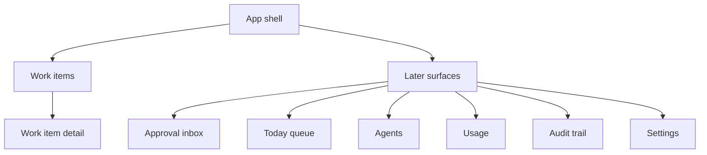

# UI/UX Design

> **Status: DRAFT design document. Not approved. Not implemented.** No screen exists. All implementation gates are on HOLD.
> Sources: `docs/BUSINESS_BLUEPRINT.md` (section 7), `docs/MASTER_BUILD_REGISTER.md` (UI-01 to UI-05, RPT-03, RPT-04).
> Brand, component library, and app style are **TBD (D-10)**. Category names and field labels are **TBD (D-01)**; wireframes use placeholders in angle brackets. No customer names or data are shown.

## 1. Design principles

| Principle | Reason |
|---|---|
| Masked by default; no unmask control in the MVP | Personal-data protection |
| Uncertain items are impossible to miss | Fail-closed workflow |
| Every item shows where it came from and which versions produced it | Auditability |
| Plain language; no jargon in labels | Staff are not technical |
| Approval in a few taps on a phone (Later) | Approvals are the human bottleneck |
| Visible mode banner (Shadow mode / Live) | Safety |
| Accessible: keyboard operable, readable contrast, not color-only status | Usability (exact standard TBD) |
| Server enforces permissions; UI only mirrors them | Client checks are not security (R-004) |

## 2. Framework position (R-004; register rows PENDING)

| Option | Use |
|---|---|
| Custom UI on a component library | Customer shell (UI-01): not CRUD pages |
| `refinedev/refine` (headless, MIT) | Candidate for CRUD screens (UI-02), PENDING |
| `marmelab/react-admin` (MIT; paid Enterprise modules) | Candidate for the internal platform-admin console (UI-03), PENDING |
| Orchester pages | Rejected as a base (UI-05) |

## 3. Information architecture



Navigation (MVP): a single left or top item "Work items". Later items appear as agents ship.

## 4. MVP screens

### 4.1 S-01 Work item list (read-only)

```
+--------------------------------------------------------------------------+
| <Product>            [Shadow mode: nothing is sent]          <User> v     |
+--------------------------------------------------------------------------+
| Work items                                                                |
| Status: [All v]  Category: [All v]  Search: [______________]  [Clear]     |
+--------------------------------------------------------------------------+
| Status        | Category      | Received       | Confidence | Flags       |
|---------------+---------------+----------------+------------+-------------|
| Ready         | <category>    | <date, time>   | <value>    |             |
| Needs review  | <category>    | <date, time>   | <value>    | Missing: 2  |
| Needs review  | Unknown       | <date, time>   | --         | Detector off|
|                                                                          |
| Showing 1-25 of <n>                               [ < Prev ]  [ Next > ]  |
+--------------------------------------------------------------------------+
```

| Element | Behavior |
|---|---|
| Mode banner | Always visible; text depends on mode (D-13) |
| Status chip | Text plus icon, not color only |
| Row click | Opens S-02 |
| Empty state | "No items yet. Messages sent to the connected channel appear here." |
| Loading state | Skeleton rows |
| Error state | "We couldn't load items. Try again." plus a reference id (the correlation id) |
| Permissions | Rows limited to the user's tenant by the server (AT-21) |

### 4.2 S-02 Work item detail (read-only)

```
+--------------------------------------------------------------------------+
| < Back to list                                       Status: Needs review |
+--------------------------------------------------------------------------+
| Category: <category>                  Confidence: <value>                 |
| Received: <date, time>   Channel: <channel>   Item id: <id>               |
+--------------------------------------------------------------------------+
| Message (masked)                                                          |
| +----------------------------------------------------------------------+ |
| | <text with tokens such as [PERSON_1], [CONTACT_1]>                   | |
| +----------------------------------------------------------------------+ |
| Personal data found: <type> x <count>, <type> x <count>                   |
+--------------------------------------------------------------------------+
| Extracted fields                                                          |
| Field         | Value (masked)   | Confidence | Found                     |
| <field>       | <value>          | <value>    | Yes                       |
| <field>       | --               | --         | No (missing)              |
+--------------------------------------------------------------------------+
| Why this needs review: <reason list>                                      |
+--------------------------------------------------------------------------+
| Produced by: <skill> v<ver>  model <id>  prompt v<ver>   [View audit]*   |
+--------------------------------------------------------------------------+
  * "View audit" is Later.
```

No edit, approve, send, or unmask controls in the MVP.

## 5. Later screens (outlines; not specified further)

### 5.1 Approval inbox (mobile-first)

```
+--------------------------------+
| Approvals (<n> waiting)        |
+--------------------------------+
| <Action summary>               |
| For: <item reference>          |
| Why: <reason>                  |
| Evidence: [View]               |
| Expires: <time>                |
|  [ Decline ]      [ Approve ]  |
+--------------------------------+
```

Rules: approver identity and role checked by the server before the action; reason required for Decline; expiry shown; an already-resolved request shows "Someone already decided".

### 5.2 Other Later surfaces

| Surface | Purpose | Register rows |
|---|---|---|
| Today queue | Prioritized items needing attention | UI-01 |
| Agents | Status, tier, pause each agent, pause all | UI-01 |
| Usage | Spend against the cap | FND-09, RPT-01 |
| Audit trail | Searchable, verified history | RPT-04, FND-03 |
| Reports and dashboards | Output of Reporting | RPT-02, RPT-03 |
| Settings | Categories, rules, tiers, channel | D-01, D-08 |
| Platform-admin console | Tenants, health, support | UI-03 |

## 6. Global patterns

| Pattern | Rule |
|---|---|
| Mode banner | Shadow mode text from D-13; kill-switch banner: "Processing is paused" |
| Status vocabulary | Ready, Needs review, Rejected (words fixed once D-01 is decided) |
| Confidence | Shown as a value and a qualitative label; thresholds TBD (D-04) |
| Time display | Local time zone setting TBD |
| Errors | Plain sentence plus a reference id; never raw error text |
| Sensitive data | Never displayed raw; no copy-raw action |
| Responsive | Works on a phone width; tables collapse to cards |
| Language | English for the pilot; localization TBD (D-11) |

## 7. Accessibility checklist (standard TBD)

Keyboard focus order; visible focus; labels on inputs; status not color-only; contrast; screen-reader names for icons; reduced-motion respect; error messages tied to fields.

## 8. UI acceptance tests

| Test | Check |
|---|---|
| AT-21 | Staff of tenants A and B each see only their items, masked; no unmask control exists |
| UI-T1 (new) | Empty, loading, and error states render as specified |
| UI-T2 (new) | List and detail pass the accessibility checklist |
| UI-T3 (new) | Mode banner is visible on every screen |
| UI-T4 (new) | Page source and network responses contain no raw synthetic values |

UI-T1 to UI-T4 are proposals and are not yet in `DEPLOYMENT_TESTING.md`'s numbered list.

## 9. Component ownership

| Component | Owner | Origin | Verdict |
|---|---|---|---|
| Work-item list and detail | Our own | n/a | BUILD (UI-01 reduced) |
| App shell, routing, sessions | Our own | Candidate frameworks PENDING | UI-01..UI-03 |
| Tenant-aware data access | Server, row-level security | Orchester pattern | FND-02 |
| Orchester pages (brain, flows, teams) | Not used | Orchester | REJECT (UI-05) |

## 10. Completeness of this document

| Part | Status |
|---|---|
| MVP screens S-01 and S-02 with layouts and states | Complete for the proposed MVP |
| Later screens | **Outline only** |
| Visual design, brand, component library | **Not started: TBD (D-10)** |
| Labels, categories, field names | **Not started: TBD (D-01)** |
| Accessibility standard | **TBD** |
