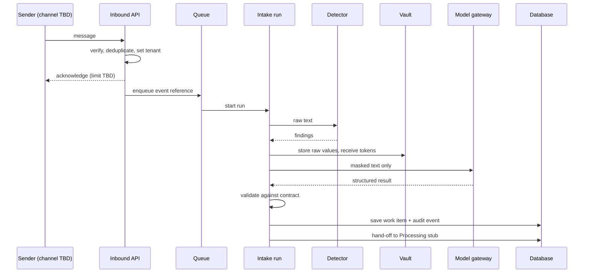
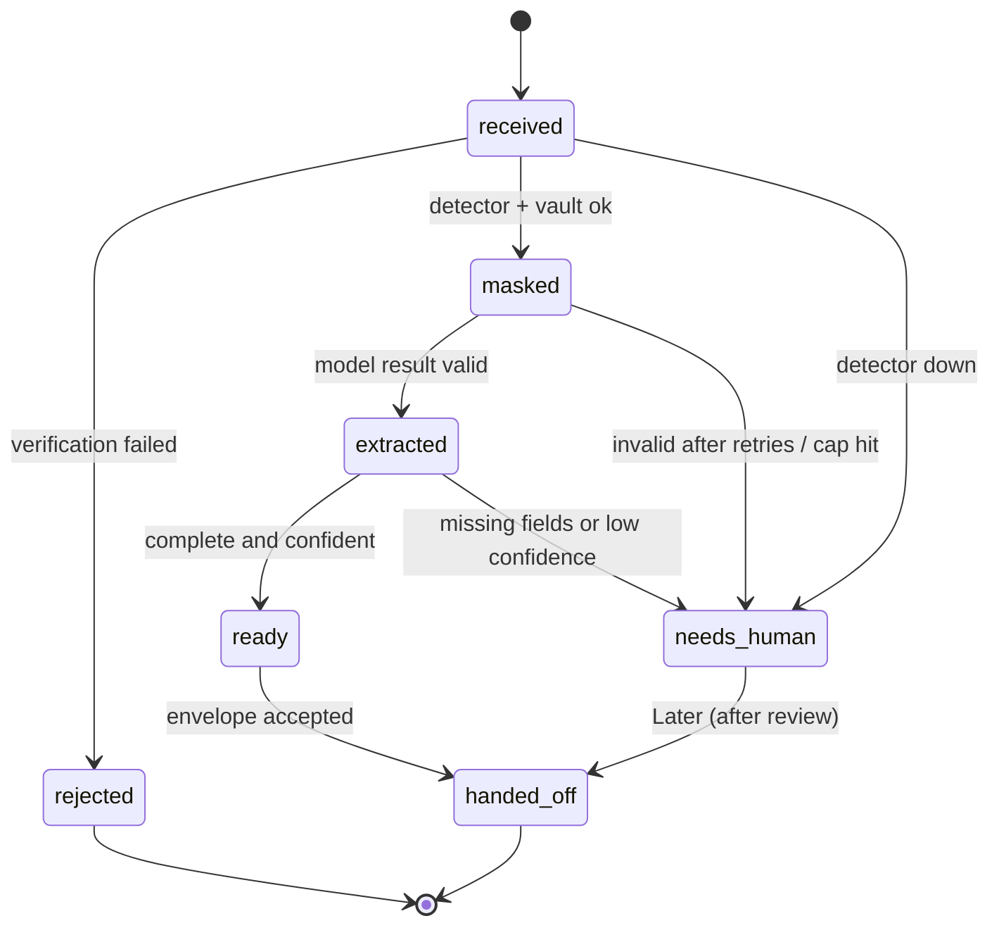
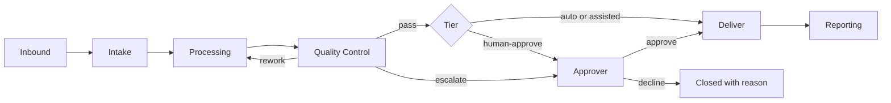

# User and System Flows

> **Status: DRAFT design document. Not approved. Not implemented.** All implementation gates are on HOLD.
> Sources: `docs/BUSINESS_BLUEPRINT.md` (section 5), `docs/MASTER_BUILD_REGISTER.md`.
> The channel (D-02), vertical (D-01), and customer integrations are **TBD**. Flows use generic wording.

## 1. Flow index

| ID | Flow | Phase |
|---|---|---|
| F-01 | Intake pilot (shadow mode) | MVP |
| F-02 | Staff review of work items | MVP |
| F-03 | Exception handling | MVP |
| F-04 | Work item lifecycle (states) | MVP |
| F-05 | Customer onboarding | Later (content TBD) |
| F-06 | End-to-end pipeline with approval | Later |
| F-07 | Approval and resume | Later |
| F-08 | Customer export and deletion | Later |
| F-09 | Skill release and rollback | Later (repository-loaded for the MVP) |
| F-10 | Incident response | MVP (procedure), tooling Later |

## 2. F-01 Intake pilot (shadow mode, proposed D-13)

| Step | Actor | Action | Failure response | Test |
|---|---|---|---|---|
| 1 | Sender | Sends a message to the one channel | n/a | |
| 2 | Inbound API | Verifies signature or secret and timestamp | Reject; audit without body | AT-05 |
| 3 | Inbound API | Checks delivery id | Duplicate: return the stored result | AT-06 |
| 4 | Inbound API | Sets tenant context from the channel record | Missing: reject | AT-03 |
| 5 | Inbound API | Acknowledges, enqueues a reference | Slow: provider limit applies | AT-07 |
| 6 | Intake run | Sends raw text to the detector | Detector down: `needs-human`, no model call | AT-13 |
| 7 | Intake run | Stores raw values in the vault; builds masked text | Vault error: stop, `needs-human` | AT-10 |
| 8 | Intake run | Calls the model gateway with masked text | Invalid output: bounded retries, then `needs-human` | AT-12 |
| 9 | Intake run | Validates against `work_item.v1` | Invalid: `needs-human` | AT-14 |
| 10 | Intake run | Saves item and audit event | Duplicate on restart: no second item | AT-22 |
| 11 | Intake run | Hands the envelope to the Processing stub | Version mismatch: rejected | AT-20 |

Nothing is sent back to the sender (AT-16).

## 3. F-02 Staff review (MVP, read-only)

1. Staff sign in. The session's tenant is set.
2. Staff open the work-item list. They see only their tenant's items with masked content.
3. They filter by status (`ready` / `needs-human`) and category.
4. They open an item to see fields, confidence, reasons, and versions.
5. There is no edit, no unmask, no send. (Edit and approve actions are Later.)

Test: AT-21.

## 4. F-03 Exception handling

| Case | Detection | System behavior | What staff see |
|---|---|---|---|
| Forged or stale inbound | Verification fails | Reject; audit event without body | Nothing |
| Duplicate delivery | Delivery id seen | Return the stored result | One item |
| Detector unavailable | Health check or call error | Park item `needs-human`; no raw text to a model | Item flagged with reason "detector unavailable" |
| Model output invalid after N retries | Schema check | `needs-human` | Item flagged with reason |
| Unparseable classification | Parse failure | Category `unknown`; `needs-human` | Item flagged |
| Token cap hit | Cap check | Stop; `needs-human` | Item flagged |
| Kill switch on | Flag | No model call; inbound behavior TBD | Banner (design in `UI_UX_DESIGN.md`) |
| Process killed mid-run | Restart | Complete once or retry without duplicate | Item appears once |
| Missing tenant context | Context check | Reject | Nothing |

## 5. F-04 Work item lifecycle

State names are proposals. Every transition writes an audit event (AT-15).

## 6. F-05 Customer onboarding (Later; content TBD)

| Step | Content | Status |
|---|---|---|
| 1 | Create tenant and admin account | TBD |
| 2 | Connect the inbound channel | TBD (D-02) |
| 3 | Define categories, fields, and rules | TBD (D-01) |
| 4 | Set policy tiers, spend cap | TBD (D-08, D-12) |
| 5 | Run in shadow mode and review results | Proposed |
| 6 | Promote actions to higher tiers after review | Proposed (D-08) |

## 7. F-06 End-to-end pipeline with approval (Later)

## 8. F-07 Approval and resume (Later)

| Step | Behavior | Reference |
|---|---|---|
| 1 | A run reaches a Human-approve step and stops; state is saved | Mastra snapshot design (register FND-05) |
| 2 | The approver opens the request, sees reason and evidence | UI-01 |
| 3 | The API checks the approver's identity, role, workspace, and the exact action | FND-07 (our own; Mastra's check is optional and enterprise-licensed) |
| 4 | The decision, reason, time, and expiry are recorded | FND-07, FND-03 |
| 5 | Approval claims the run atomically; a second approver gets "already resolved" | Mastra claim design |
| 6 | The run continues; steps with side effects are idempotent | PRC-04 |
| 7 | Decline closes the run with the reason | FND-24 |
| 8 | A restart does not lose a pending approval; a mid-step crash repeats later steps | `run-recovery.md` |

Pending approvals expire after a period TBD.

## 9. F-08 Export and deletion (Later; required before real customer data)

1. Authorized request recorded in `data_requests`.
2. Export or delete across messages, work items, vault, findings, and vectors (if any).
3. Vault entries and keys deleted or crypto-shredded (method TBD).
4. A completion record is kept without personal data.
5. Verification query confirms no remaining raw values.

## 10. F-09 Skill release and rollback

| Phase | Steps |
|---|---|
| MVP | Skills are files in the repository; CI validates them (AT-01, AT-02) |
| Later | Build signed bundle → staging evaluation → shadow → canary tenants → general release → rollback by repinning the version |

## 11. F-10 Incident response (procedure)

1. Detect (alert or report).
2. Classify severity (levels TBD).
3. Contain: kill switch; disable channel; pause tenant.
4. Preserve evidence (audit chain, correlation ids; no raw data copies).
5. Investigate and fix.
6. Notify as required (rules TBD, D-11).
7. Record the incident and follow-ups.

## 12. Completeness of this document

| Part | Status |
|---|---|
| F-01 to F-04, F-10 | Complete for the proposed MVP |
| F-06 to F-09 | **Partial: design outline; depend on D-05, D-06, D-08, D-11, D-12** |
| F-05 onboarding | **Incomplete: content TBD (D-01, D-02)** |
| Channel-specific details | **Incomplete: D-02** |
